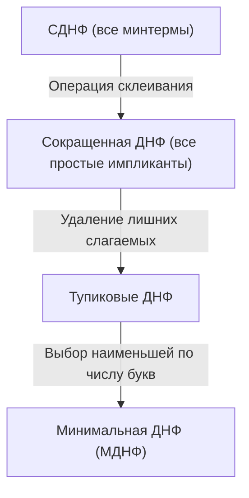
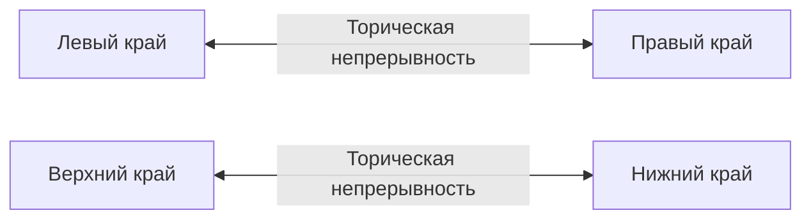

# Минимизация булевых функций: алгоритмы и карты Карно

Конспект составлен на основе объединённых лекционных курсов дискретной математики **Пермякова А.С.** и **Страдиной М.В.**

---

## 1. Постановка задачи минимизации

Совершенные формы (СДНФ и СКНФ) аппаратно избыточны: для функции от $n$ переменных каждый минтерм содержит ровно $n$ букв. При физической реализации в виде интегральных схем каждый логический элемент и каждый вход увеличивают площадь кристалла, энергопотребление и задержку распространения сигнала.

> [!NOTE]
> **Критерий сложности ДНФ (индекс сложности):**
> Сложность ДНФ оценивается двумя взаимосвязанными параметрами:
> 1. Число конъюнкций (слагаемых).
> 2. Общее число букв (вхождений переменных) в формуле.
>
> **Минимальной ДНФ (МДНФ)** называется дизъюнктивная нормальная форма, эквивалентная исходной функции $f$ и содержащая наименьшее возможное суммарное число вхождений переменных.

---

## 2. Импликанты, простые и ядровые импликанты

> [!NOTE]
> Конъюнкция $K$ называется **импликантой** функции $f$ ($K \implies f$ или $K \le f$), если на любом наборе аргументов, где $K = 1$, значение функции $f = 1$.
> То есть множество единичных наборов конъюнкции $K$ является подмножеством единичных наборов функции $f$:
> $$N_K \subseteq N_f$$

> [!NOTE]
> - **Простой импликантой (Prime Implicant)** называется импликанта $K$ функции $f$, никакая собственная часть которой не является импликантой $f$. Иными словами, удаление хотя бы одного сомножителя из $K$ превращает её в выражение, не являющееся импликантой $f$.
> - **Сокращённой ДНФ** называется дизъюнкция **всех** простых импликант функции $f$.
> - **Тупиковой ДНФ** называется дизъюнкция простых импликант, удаление любой из которых нарушает эквивалентность формулы функции $f$ (в ней нет лишних простых импликант).
> - **Ядровой (существенной) импликантой (Essential Prime Implicant)** называется простая импликанта, покрывающая хотя бы один единичный набор функции, который **не покрывается никакой другой** простой импликантой.



> [!IMPORTANT]
> **Теорема о ядре:**
> Все ядровые простые импликанты **обязаны входить в любую** минимальную ДНФ.

---

## 3. Аналитический метод Куайна (Quine's Method)

Метод Уилларда Куайна основан на последовательном применении двух равносильностей:
1. **Закон неполного склеивания:**
   $$A \cdot x \lor A \cdot \overline{x} = A \cdot (x \lor \overline{x}) = A$$
   *(где $A$ — элементарная конъюнкция).*
2. **Закон поглощения:**
   $$A \lor A \cdot B = A$$

### Этапы метода Куайна:
1. Исходная функция представляется в СДНФ.
2. Проводится операция склеивания по всем возможным парам слагаемых, различающимся ровно в одном разряде. При этом исходные минтермы сохраняются:
   $$A x \lor A \overline{x} \lor B = A x \lor A \overline{x} \lor A \lor B$$
3. Применяется закон поглощения: элементарные конъюнкции меньшего ранга поглощают породившие их конъюнкции большего ранга ($A$ поглощает $Ax$ и $A\overline{x}$).
4. Процесс склеивания и поглощения повторяется для полученных импликант меньшего ранга до тех пор, пока возможны новые склеивания. Оставшиеся непоглощёнными конъюнкции составляют **сокращённую ДНФ**.

---

## 4. Табличный метод Куайна — Мак-Класки (Quine-McCluskey Method)

Для программной реализации метод Куайна был алгоритмизирован Эдвардом Мак-Класки (1956).

### Шаг 1: Группировка минтермов по весу Хэмминга
Минтермы группируются по количеству единиц в их двоичной записи (весу). Склеивание возможно **только между соседними группами**, отличающимися по числу единиц ровно на 1.

*Пример:*
- Минтерм $m_5 = (0, 1, 0, 1)$ имеет 2 единицы (группа 2).
- Минтерм $m_7 = (0, 1, 1, 1)$ имеет 3 единицы (группа 3).
- Они отличаются в 3-м бите и склеиваются в $(0, 1, -, 1)$, что соответствует конъюнкции $\overline{x_1} x_2 x_4$.

### Шаг 2: Итеративное склеивание
Склеенные термы помечаются прочерком `-`. Склеивание продолжается для термов с одинаковыми позициями прочерков. Все термы, оставшиеся без «галочки» склеивания, объявляются **простыми импликантами**.

### Шаг 3: Таблица покрытия (Prime Implicant Chart)
Строится матрица покрытия:
- **Строки:** найденные простые импликанты.
- **Столбцы:** исходные единичные наборы (минтермы).
- На пересечении ставится метка $\times$, если импликанта покрывает данный минтерм.

```
+--------------------+----+----+----+----+----+----+
| Простая импликанта | m1 | m3 | m5 | m7 | m9 | m11|
+--------------------+----+----+----+----+----+----+
| P1: x3' x4         | X  |    | X  |    | X  |    |
| P2: x2' x4         | X  | X  |    |    | X  | X  |
| P3: x2 x4          |    | X  |    | X  |    | X  |
+--------------------+----+----+----+----+----+----+
```

1. **Поиск ядровых импликант:** находятся столбцы, содержащие ровно один знак $\times$. Соответствующая строка является ядровой импликантой и обязательно включается в МДНФ.
2. Столбцы, покрытые выбранными ядровыми импликантами, вычеркиваются.
3. Оставшаяся часть таблицы минимизируется правилами доминирования строк и столбцов либо **методом Петрика** (булевым уравнением покрытия).

---

## 5. Карты Карно (Karnaugh Maps / Диаграммы Вейча)

Карта Карно — это графическая развёртка $n$-мерного булева куба на плоскость, в которой соседние по горизонтали и вертикали клетки отличаются **ровно в одной переменной**.

> [!NOTE]
> Для упорядочения строк и столбцов карты Карно используется **код Грея (Gray code)**:
> `00`, `01`, `11`, `10`
> *(Соседние коды отличаются ровно в одном бите, включая переход от `10` к `00`)*.

### Свойства торической связности
Карта Карно топологически замкнута в тор:
- Верхний край карты склеен с нижним.
- Левый край карты склеен с правым.
- Четыре крайние угловые клетки карты $4 \times 4$ образуют **одну смежную группу** размера 4!



---

### Карта Карно для 4 переменных ($A, B, C, D$)

Переменные $AB$ кодируют строки, $CD$ — столбцы:

| $AB \backslash CD$ | **00** ($\overline{C}\overline{D}$) | **01** ($\overline{C}D$) | **11** ($CD$) | **10** ($C\overline{D}$) |
| :---: | :---: | :---: | :---: | :---: |
| **00** ($\overline{A}\overline{B}$) | $m_0$ | $m_1$ | $m_3$ | $m_2$ |
| **01** ($\overline{A}B$) | $m_4$ | $m_5$ | $m_7$ | $m_6$ |
| **11** ($AB$) | $m_{12}$ | $m_{13}$ | $m_{15}$ | $m_{14}$ |
| **10** ($A\overline{B}$) | $m_8$ | $m_9$ | $m_{11}$ | $m_{10}$ |

---

### Правила склеивания на карте Карно

> [!IMPORTANT]
> 1. Объединяются только прямоугольные блоки клеток, содержащих единицы, с размерами сторон, равными **степеням двойки**:
>    $$1 \times 1, \; 1 \times 2, \; 2 \times 1, \; 2 \times 2, \; 1 \times 4, \; 4 \times 1, \; 2 \times 4, \; 4 \times 2, \; 4 \times 4$$
> 2. Блок размера $2^k$ устраняет $k$ переменных:
>    - Блок из 2 единиц устраняет 1 переменную.
>    - Блок из 4 единиц устраняет 2 переменные.
>    - Блок из 8 единиц устраняет 3 переменные.
> 3. Блоки должны выбираться **максимально возможного размера**.
> 4. Каждая единица должна войти хотя бы в один блок. Число выбранных блоков должно быть минимальным.
> 5. Блоки могут взаимно пересекаться.

---

### Карты Карно для 5 переменных

Для 5 переменных ($A, B, C, D, E$) строятся две параллельные карты $4 \times 4$:
- Первая карта для $A = 0$.
- Вторая карта для $A = 1$.
Склеивание происходит не только внутри каждой плоскости, но и **между одинаковыми клетками двух плоскостей** (вдоль третьего пространственного измерения).

---

## 6. Минимизация недоопределённых булевых функций

В инженерной практике некоторые входные комбинации сигналов физически невозможны или их выход не имеет значения. Такие состояния называются **безразличными / неопределёнными (Don't care conditions)** и обозначаются символом **$X$** (или $d$).

> [!TIP]
> **Правило оптимального доопределения:**
> Клетки с символом $X$ включаются в блоки единиц **только в том случае, если это позволяет увеличить размер прямоугольника** (и тем самым уменьшить число букв в импликанте). Непокрытые клетки $X$ просто игнорируются (доопределяются нулями).
