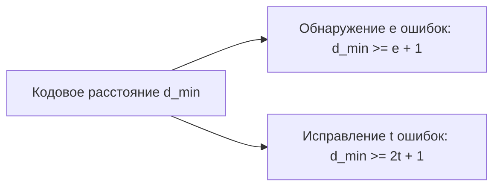

# Помехоустойчивое кодирование и коды Хэмминга

Конспект составлен на основе объединённых лекционных курсов дискретной математики **Пермякова А.С.** и **Страдиной М.В.**

---

## 1. Проблема передачи данных по каналу с шумом

При передаче информации по реальным физическим каналам связи (радиоэфир, оптоволокно, оперативная память) неизбежно возникают помехи, приводящие к случайной инверсии битов ($0 \to 1$ или $1 \to 0$).

> [!NOTE]
> **Помехоустойчивым (избыточным) кодированием** называется добавление к полезным информационным битам строго выверенной проверочной избыточности (контрольных битов), позволяющей на приемной стороне:
> 1. **Обнаруживать (Detect)** наличие ошибок в блоке данных.
> 2. **Локализовать и исправлять (Correct)** искаженные биты без повторного запроса передачи.

---

## 2. Метрика Хэмминга и векторное пространство $\mathbb{F}_2^n$

Множество всех двоичных векторов длины $n$ рассматривается как $n$-мерное векторное пространство над полем $\mathbb{F}_2 = \{0, 1\}$.

> [!NOTE]
> - **Весом Хэмминга (Hamming weight)** вектора $x = (x_1, \dots, x_n) \in \{0, 1\}^n$ называется количество его ненулевых координат:
>   $$w(x) = |\{ i \mid x_i = 1 \}|$$
> - **Расстоянием Хэмминга (Hamming distance)** между двумя векторами $x, y \in \{0, 1\}^n$ называется количество позиций, в которых эти векторы различаются:
>   $$d(x, y) = w(x \oplus y) = |\{ i \mid x_i \ne y_i \}|$$

### Аксиомы метрики
Расстояние Хэмминга удовлетворяет всем аксиомам метрического пространства:
1. $d(x, y) \ge 0$, причём $d(x, y) = 0 \iff x = y$.
2. Симметричность: $d(x, y) = d(y, x)$.
3. Неравенство треугольника: $d(x, z) \le d(x, y) + d(y, z)$.

---

## 3. Кодовое расстояние и критерии коррекции ошибок

> [!NOTE]
> **Минимальным кодовым расстоянием** кода $C \subseteq \{0, 1\}^n$ называется наименьшее расстояние Хэмминга между двумя различными кодовыми словами:
> $$d_{\min}(C) = \min_{\substack{x, y \in C \\ x \ne y}} d(x, y)$$



> [!IMPORTANT]
> **Фундаментальные теоремы помехоустойчивости:**
> 1. **Критерий обнаружения $e$ ошибок:**
>    Код $C$ обнаруживает любую кратность ошибок до $e$ включительно тогда и только тогда, когда:
>    $$d_{\min} \ge e + 1$$
>    *(Если произойдет $\le e$ инверсий, кодовое слово сместится в некодовую точку и не совпадет ни с одним другим кодовым словом).*
>
> 2. **Критерий исправления $t$ ошибок:**
>    Код $C$ способен гарантированно исправить любые $t$ ошибок тогда и только тогда, когда:
>    $$d_{\min} \ge 2t + 1$$
>    *(Сферы радиуса $t$ с центрами в разрешенных кодовых словах попарно не пересекаются, что позволяет однозначно сопоставить искаженный вектор ближайшему кодовому слову по принципу максимального правдоподобия).*

### Граница Хэмминга (сферическая граница)

Объем сферы радиуса $t$ в $n$-мерном кубе равен числу векторов, отличающихся от центра не более чем в $t$ битах:
$$V(n, t) = \sum_{i=0}^t \binom{n}{i}$$
Так как сферы вокруг кодовых слов не пересекаются, их суммарный объем не может превосходить емкость всего пространства $2^n$:
$$|C| \cdot \sum_{i=0}^t \binom{n}{i} \le 2^n$$

Коды, на которых достигается равенство в границе Хэмминга, называются **плотно упакованными (совершенными / perfect codes)**.

---

## 4. Линейные блоковые коды

> [!NOTE]
> Блоковый код длины $n$ с $k$ информационными разрядами называется **линейным кодом** $(n, k)$, если множество его разрешенных кодовых слов образует линейное $k$-мерное подпространство в $\mathbb{F}_2^n$.
> Число проверочных битов: $r = n - k$.

- **Порождающая матрица $G$** размера $k \times n$: кодирование вектора данных $m = (m_1, \dots, m_k)$ выполняется умножением:
  $$c = m \cdot G \pmod 2$$
- **Проверочная матрица $H$** размера $r \times n$: вектор $c \in \mathbb{F}_2^n$ является разрешенным кодовым словом тогда и только тогда, когда:
  $$c \cdot H^T = \mathbf{0} \pmod 2$$
- **Условие ортогональности:**
  $$G \cdot H^T = \mathbf{0}$$

### Синдромное декодирование
Пусть передавалось кодовое слово $c \in C$, а из-за шума был принят вектор $y = c \oplus e$, где $e$ — вектор ошибки ($e_i = 1$, если в $i$-м бите произошел сбой).
Вычисляется **вектор синдрома $S$**:
$$S = y \cdot H^T = (c \oplus e) \cdot H^T = c H^T \oplus e H^T = \mathbf{0} \oplus e H^T = e \cdot H^T$$

> [!TIP]
> Синдром **зависит исключительно от вектора ошибки $e$** и совершенно не зависит от передаваемого сообщения $c$!

---

## 5. Классический код Хэмминга $(7, 4)$

В 1950 году Ричард Хэмминг разработал код с параметрами $n = 7, k = 4, r = 3$ и $d_{\min} = 3$, исправляющий **любую одиночную ошибку** ($t = 1$).

### Правило размещения битов Хэмминга
В блоке из 7 бит:
- **Контрольные (проверочные) биты $p_1, p_2, p_4$** размещаются строго на позициях, являющихся степенями двойки: $1, 2, 4$ ($2^0, 2^1, 2^2$).
- **Информационные биты $d_1, d_2, d_3, d_4$** занимают остальные позиции: $3, 5, 6, 7$.

```
Позиция бита:   1    2    3    4    5    6    7
Двоичный код:  001  010  011  100  101  110  111
Тип бита:       p1   p2   d1   p3   d2   d3   d4
```

Каждый проверочный бит $p_i$ отвечает за четность тех позиций, в двоичной записи номера которых $i$-й разряд равен 1:
- **$p_1$ (позиция 1, бит `..1`):** проверяет биты $\{1, 3, 5, 7\} \implies p_1 = d_1 \oplus d_2 \oplus d_4$.
- **$p_2$ (позиция 2, бит `.1.`):** проверяет биты $\{2, 3, 6, 7\} \implies p_2 = d_1 \oplus d_3 \oplus d_4$.
- **$p_3$ (позиция 4, бит `1..`):** проверяет биты $\{4, 5, 6, 7\} \implies p_3 = d_2 \oplus d_3 \oplus d_4$.

---

### Алгоритм исправления ошибки в коде Хэмминга $(7, 4)$

На приемной стороне вычисляются три бита синдрома:
$$s_1 = y_1 \oplus y_3 \oplus y_5 \oplus y_7$$
$$s_2 = y_2 \oplus y_3 \oplus y_6 \oplus y_7$$
$$s_3 = y_4 \oplus y_5 \oplus y_6 \oplus y_7$$

> [!IMPORTANT]
> Двоичное число $S = (s_3 \, s_2 \, s_1)_2$ **напрямую указывает номер ошибочного бита**!
> - Если $S = 000_2 = 0$, то ошибок нет.
> - Если $S = 101_2 = 5$, то ошибка произошла в 5-м бите ($y_5$). Для исправления достаточно инвертировать этот бит: $y_5 \leftarrow y_5 \oplus 1$.

---

## 6. Расширенный код Хэмминга $(8, 4)$ (SECDED)

Классический код Хэмминга $(7, 4)$ при двойной ошибке указывает на ложный бит и производит неверную коррекцию. Для предотвращения этого в серверной памяти DDR ECC применяется расширенный код **SECDED (Single Error Correction, Double Error Detection)**.

- К 7 битам добавляется **8-й бит общей чётности** $p_0$ по всему блоку:
  $$p_0 = \bigoplus_{i=1}^7 y_i$$
- Кодовое расстояние увеличивается до $d_{\min} = 4$.

### Логика декодера SECDED:
1. $S = 0$ и общая четность сошлась: **Ошибок нет**.
2. $S \ne 0$ и общая четность нарушена (нечётная): **Одиночная ошибка в позиции $S$** (успешно исправляется).
3. $S \ne 0$ и общая четность сошлась (чётная): **Двойная ошибка обнаружена!** (Исправление невозможно, ядро ОС получает прерывание MCE — Machine Check Exception).
