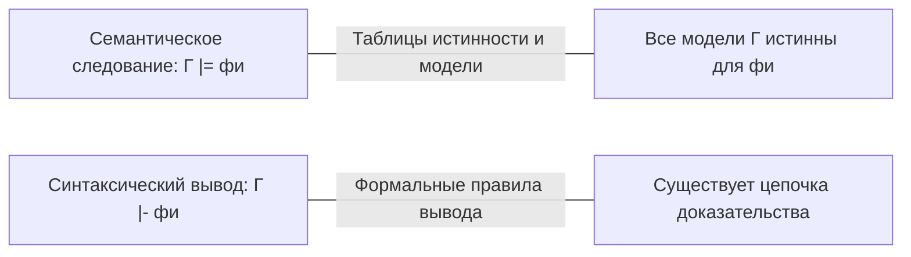
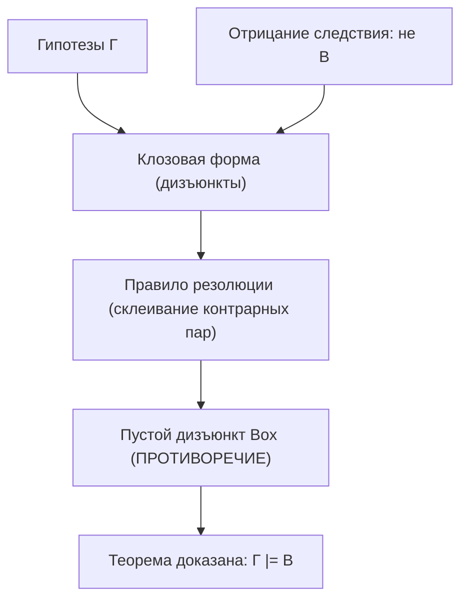

# Формальная логика: предикаты, резолюции и логический вывод

Конспект составлен на основе объединённых лекционных курсов дискретной математики **Пермякова А.С.** и **Страдиной М.В.**

---

## 1. Пропозициональная логика: синтаксис и семантика

> [!NOTE]
> **Формальная логика** — наука о законах правильного рассуждения, отделяющая истинные умозаключения от ложных независимо от конкретного материального содержания высказываний.

### Синтаксис формул (Well-Formed Formulas, WFF)

Язык логики высказываний строится индуктивно из:
1. **Пропозициональных переменных (атомов):** $P, Q, R, \dots \in V$.
2. **Логических связок:** $\neg$ (отрицание), $\land$ (конъюнкция), $\lor$ (дизъюнкция), $\implies$ (импликация), $\iff$ (эквивалентность).
3. **Скобок:** $(, )$.

**Индуктивное правило построения WFF:**
- Базис: любой атом $P$ является WFF.
- Шаг: если $\varphi$ и $\psi$ — WFF, то $(\neg \varphi)$, $(\varphi \land \psi)$, $(\varphi \lor \psi)$, $(\varphi \implies \psi)$, $(\varphi \iff \psi)$ также являются WFF.

---

### Семантика: Интерпретация и общезначимость

> [!NOTE]
> - **Интерпретацией (Interpretation)** называется функция $\nu: V \to \{0, 1\}$, сопоставляющая каждой переменной значение истинности.
> - **Тавтология (Tautology / общезначимая формула):** формула, истинная при **любой** возможной интерпретации ($\models \varphi$).
> - **Противоречие (Contradiction / невыполнимая формула):** формула, ложная при **любой** интерпретации.
> - **Выполнимая формула:** формула, истинная хотя бы при одной интерпретации.

> [!TIP]
> **Понятие пустой истины (Vacuous Truth):**
> Импликация $P \implies Q$ истинна всегда, когда посылка $P$ ложна ($\text{Ложь} \implies \text{что угодно} \equiv \text{Истина}$).
> *Пример:* утверждение «Все единороги на Марсе имеют розовый цвет» формально истинно, так как единорогов на Марсе не существует.

---

### Семантическое следование ($\models$) против Синтаксического вывода ($\vdash$)

В лекциях Пермякова А.С. и Страдиной М.В. акцентируется строгое различие между двумя фундаментальными символами:

> [!NOTE]
> - **Семантическое следование ($\Gamma \models \varphi$):** формула $\varphi$ следует из множества посылок $\Gamma$, если в любой интерпретации $\nu$, где истинны все формулы из $\Gamma$, формула $\varphi$ также истинна.
> - **Синтаксический вывод ($\Gamma \vdash \varphi$):** существует конечная последовательность формул (вывод), где каждый шаг либо посылка из $\Gamma$, либо аксиома, либо получен по правилу вывода (например, *Modus Ponens*: $\frac{A, \; A \implies B}{B}$).

> [!IMPORTANT]
> **Теоремы о связи синтаксиса и семантики (Курт Гёдель):**
> 1. **Теорема о корректности (Soundness):** всё, что выводимо, истинно:
>    $$\Gamma \vdash \varphi \implies \Gamma \models \varphi$$
> 2. **Теорема о полноте (Completeness):** всё, что семантически истинно, выводимо:
>    $$\Gamma \models \varphi \implies \Gamma \vdash \varphi$$

---

## 2. Логика предикатов первого порядка

Пропозициональная логика не способна выразить внутреннюю структуру утверждений. Для этого вводится логика предикатов.

> [!NOTE]
> - **Предикатом** $P(x_1, x_2, \dots, x_k)$ называется логическая функция, определенная на предметной области $D$, ставящая в соответствие кортежу объектов значение $\mathbf{0}$ или $\mathbf{1}$.
> - **Квантор всеобщности ($\forall$):** $\forall x \, P(x)$ означает: «для всех $x$ из предметной области предикат $P(x)$ истинен».
> - **Квантор существования ($\exists$):** $\exists x \, P(x)$ означает: «существует хотя бы один объект $x$ в предметной области, для которого $P(x)$ истинен».

### Законы отрицания кванторов (де Морган для кванторов)

$$\neg(\forall x \, P(x)) \equiv \exists x \, \neg P(x)$$
$$\neg(\exists x \, P(x)) \equiv \forall x \, \neg P(x)$$

### Законы дистрибутивности кванторов

- Для квантора всеобщности:
  $$\forall x \, (P(x) \land Q(x)) \equiv (\forall x \, P(x)) \land (\forall x \, Q(x))$$
  $$\forall x \, (P(x) \lor Q(x)) \not\equiv (\forall x \, P(x)) \lor (\forall x \, Q(x)) \quad (\text{влечёт только } \impliedby)$$
- Для квантора существования:
  $$\exists x \, (P(x) \lor Q(x)) \equiv (\exists x \, P(x)) \lor (\exists x \, Q(x))$$
  $$\exists x \, (P(x) \land Q(x)) \not\equiv (\exists x \, P(x)) \land (\exists x \, Q(x)) \quad (\text{влечёт только } \implies)$$

---

## 3. Предварённая нормальная форма (ПНФ)

> [!NOTE]
> Формула логики предикатов находится в **предварённой нормальной форме (Prenex Normal Form, PNF)**, если все кванторы вынесены в начало формулы, а бескванторная часть (матрица) содержит только булевы связки над атомарными предикатами:
> $$Q_1 x_1 \, Q_2 x_2 \dots Q_k x_k \quad M(x_1, x_2, \dots, x_k)$$
> где $Q_i \in \{\forall, \exists\}$, а $M$ — матрица формулы.

### Алгоритм приведения к ПНФ:
1. Исключить связки $\implies$ и $\iff$ через $\neg, \lor, \land$.
2. Продвинуть знаки отрицания непосредственно к предикатам, используя законы де Моргана и законы отрицания кванторов.
3. **Переименовать связанные переменные**, чтобы имена переменных под разными кванторами не конфликтовали друг с другом и со свободными переменными.
4. Вынести кванторы в префикс формулы.

---

## 4. Сколемизация (Форма Сколема)

Для автоматического доказательства теорем необходимо избавиться от кванторов существования $\exists$. Норвежский логик Торальф Сколем предложил заменять кванторы существования функциональными символами.

> [!NOTE]
> **Правило сколемизации:**
> Если квантор существования $\exists y$ находится в области действия универсальных кванторов $\forall x_1, \forall x_2, \dots, \forall x_m$, то переменная $y$ везде в матрице заменяется на **функцию Сколема** от этих переменных:
> $$y \leftarrow f(x_1, x_2, \dots, x_m)$$
> Если перед $\exists y$ нет ни одного квантора всеобщности, переменная $y$ заменяется на **константу Сколема** $c$.

> [!WARNING]
> Формула после сколемизации **не эквивалентна** исходной формуле, но является **равновыполнимой (equisatisfiable)**: исходная формула выполнима тогда и только тогда, когда выполнима её форма Сколема.

После сколемизации все оставшиеся кванторы — это $\forall$. Их можно опустить, считая все переменные неявно связанными квантором всеобщности.

---

## 5. Метод резолюций Джона Робинсона

В 1965 году Алан Робинсон предложил метод резолюций — алгоритмическую основу автоматического доказательства теорем и языка логического программирования **Prolog**.

### Клозовая форма (CNF of Clauses)
Матрица формулы приводится к КНФ и записывается в виде множества дизъюнктов (клозов):
$$S = \{ C_1, C_2, \dots, C_m \}$$
где каждый дизъюнкт $C_i$ — это множество литералов (атомов или их отрицаний), соединённых операцией $\lor$.

### Принцип доказательства от противного (Refutation)
Чтобы доказать, что из гипотез $\Gamma = \{A_1, \dots, A_k\}$ логически следует заключение $B$ ($\Gamma \models B$):
1. Добавляют к системе **отрицание заключения**: $\neg B$.
2. Полученное множество формул $S = \{A_1, \dots, A_k, \neg B\}$ приводят к клозовой форме.
3. Применяют правило резолюции, стремясь вывести **пустой дизъюнкт $\square$** (противоречие).
4. Если пустой дизъюнкт выведен, теорема доказана!

---

### Правило резолюции в логике высказываний

Для двух дизъюнктов, содержащих взаимно противоположные (контрарные) литералы $P$ и $\neg P$:
$$\frac{A \lor P, \quad B \lor \neg P}{A \lor B}$$
Полученный дизъюнкт $A \lor B$ называется **резольвентой**.

---

## 6. Алгоритм унификации (MGU) в логике первого порядка

В логике предикатов предикаты могут содержать термы: например, $P(x, f(y))$ и $\neg P(a, z)$. Чтобы применить правило резолюции, аргументы необходимо согласовать.

> [!NOTE]
> **Унификатором** для термов $t_1$ и $t_2$ называется подстановка $\theta = \{x_1 \mapsto \tau_1, \dots, x_k \mapsto \tau_k\}$, делающая эти термы синтаксически идентичными:
> $$t_1 \theta = t_2 \theta$$
> **Наиболее общим унификатором (MGU — Most General Unifier)** называется унификатор, из которого любой другой унификатор получается дополнительной подстановкой.

### Проверка вхождения (Occurs Check)
Переменную $x$ нельзя унифицировать с термом $t$, если $x$ входит в состав терма $t$ (например, подстановка $x \mapsto f(x)$ порождает бесконечный терм $f(f(f(\dots)))$ и должна приводить к ошибке унификации).

---

### Полное правило предикатной резолюции

Если дизъюнкт $C_1$ содержит литерал $L_1$, а дизъюнкт $C_2$ содержит литерал $L_2$, и существует унификатор $\theta = \mathrm{mgu}(L_1, \neg L_2)$, то резольвента равна:
$$R(C_1, C_2) = (C_1 \setminus \{L_1\} \cup C_2 \setminus \{L_2\}) \theta$$

> [!IMPORTANT]
> **Теорема Робинсона о полноте метода резолюций:**
> Множество дизъюнктов $S$ невыполнимо тогда и только тогда, когда из него методом резолюций за конечное число шагов выводим пустой дизъюнкт $\square$.
