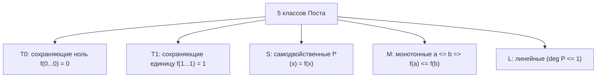

# Функциональная полнота и теорема Поста

Конспект составлен на основе объединённых лекционных курсов дискретной математики **Пермякова А.С.** и **Страдиной М.В.**

---

## 1. Замкнутые классы и оператор замыкания

В теории цифровых схем принципиален вопрос: какой минимальный набор логических вентилей достаточен для построения процессора произвольной сложности? Для ответа на него используется аппарат теории замкнутых классов булевых функций.

> [!NOTE]
> - **Суперпозицией (Superposition)** функций из множества $F$ называется функция, полученная конечным числом подстановок функций из $F$ друг в друга, отождествления переменных и переименования аргументов.
> - **Замыканием (Closure)** множества функций $F$ (обозначается $[F]$) называется множество всех булевых функций, которые могут быть получены как суперпозиции функций из $F$.
> - Множество функций $F$ называется **замкнутым классом**, если оно совпадает со своим замыканием:
>   $$[F] = F$$

### Свойства оператора замыкания

1. **Экстенсивность:** $F \subseteq [F]$.
2. **Идемпотентность:** $[[F]] = [F]$ (повторное замыкание не добавляет новых функций).
3. **Монотонность:** $F_1 \subseteq F_2 \implies [F_1] \subseteq [F_2]$.

---

## 2. Понятие функциональной полноты и базиса

> [!NOTE]
> - Система булевых функций $F$ называется **функционально полной**, если её замыкание совпадает со всем множеством всех булевых функций $P_2$:
>   $$[F] = P_2$$
> - Функционально полная система $F$ называется **базисом**, если она несократима: удаление любой функции из $F$ лишает систему свойства функциональной полноты.
> - Замкнутый класс $K \subset P_2$ называется **предполным классом**, если он не полон сам по себе, но добавление любой функции $f \notin K$ делает систему полной:
>   $$[K \cup \{f\}] = P_2$$

---

## 3. Пять предполных классов Эмиля Поста

В 1941 году американский математик Эмиль Пост доказал, что в $P_2$ существует **ровно 5 максимальных замкнутых (предполных) классов**.

---

### 3.1. Класс $T_0$ (Функции, сохраняющие ноль)

> [!NOTE]
> Функция $f(x_1, \dots, x_n)$ принадлежит классу $T_0$, если на нулевом наборе аргументов она принимает значение 0:
> $$f(0, 0, \dots, 0) = 0$$

- *Критерий проверки:* вычислить значение $f(0, \dots, 0)$.
- *Количество:* из $2^n$ наборов значение на $(0,\dots,0)$ зафиксировано, на остальных $2^n - 1$ наборах значение произвольно. Число функций $n$ переменных в $T_0$ равно:
  $$|T_0(n)| = 2^{2^n - 1}$$
- *Примеры:* $x \land y \in T_0$, $x \lor y \in T_0$, $x \oplus y \in T_0$, но $\overline{x} \notin T_0$ (так как $\overline{0} = 1$).

---

### 3.2. Класс $T_1$ (Функции, сохраняющие единицу)

> [!NOTE]
> Функция $f(x_1, \dots, x_n)$ принадлежит классу $T_1$, если на единичном наборе аргументов она принимает значение 1:
> $$f(1, 1, \dots, 1) = 1$$

- *Критерий проверки:* вычислить значение $f(1, \dots, 1)$.
- *Количество:* $|T_1(n)| = 2^{2^n - 1}$.
- *Примеры:* $x \land y \in T_1$, $x \lor y \in T_1$, но $x \oplus y \notin T_1$ (так как $1 \oplus 1 = 0$), $\overline{x} \notin T_1$.

---

### 3.3. Класс $S$ (Самодвойственные функции)

> [!NOTE]
> Функция $f$ называется **самодвойственной** ($f \in S$), если она совпадает со своей двойственной функцией:
> $$f(x_1, \dots, x_n) = f^*(x_1, \dots, x_n) = \overline{f(\overline{x_1}, \dots, \overline{x_n})}$$
> То есть на противоположных наборах аргументов функция принимает противоположные значения:
> $$f(\tilde{\alpha}) \ne f(\overline{\tilde{\alpha}})$$

- *Критерий проверки:* булев куб разбивается на $2^{n-1}$ пар противоположных наборов $(\tilde{\alpha}, \overline{\tilde{\alpha}})$. В каждой паре значения функции обязаны быть противоположными: одно 0, другое 1.
- *Количество:* $|S(n)| = 2^{2^{n-1}}$.
- *Следствие:* самодвойственная функция всегда сбалансирована — она принимает ровно $2^{n-1}$ нулей и $2^{n-1}$ единиц. Константы $0, 1 \notin S$.
- *Примеры:* $\overline{x} \in S$, $f_{\text{maj}}(x, y, z) = xy \lor yz \lor xz \in S$. Но $x \land y \notin S$.

---

### 3.4. Класс $M$ (Монотонные функции)

> [!NOTE]
> Введём отношение частичного порядка на $n$-мерном булевом кубе:
> $$(\alpha_1, \dots, \alpha_n) \le (\beta_1, \dots, \beta_n) \iff \forall i \in \{1, \dots, n\} \; (\alpha_i \le \beta_i)$$
> Функция $f$ называется **монотонной** ($f \in M$), если для любых двух сравнимых наборов значение функции не убывает:
> $$\tilde{\alpha} \le \tilde{\beta} \implies f(\tilde{\alpha}) \le f(\tilde{\beta})$$

- *Критерий проверки:* в графе булева куба при движении снизу вверх по ребрам (от $0$ к $1$) значение функции нигде не должно переключаться с $1$ на $0$ (не должно быть спуска $1 \to 0$).
- *Следствие:* В сокращённой ДНФ монотонной функции **нет ни одного отрицания переменных**!
- *Примеры:* константы $0, 1 \in M$, $x \land y \in M$, $x \lor y \in M$. Но $\overline{x} \notin M$ ($0 < 1$, но $\overline{0} = 1 > \overline{1} = 0$), $x \oplus y \notin M$.

---

### 3.5. Класс $L$ (Линейные функции)

> [!NOTE]
> Функция $f$ называется **линейной** ($f \in L$), если её полином Жегалкина не содержит произведений двух и более переменных (степень полинома не превосходит 1):
> $$f(x_1, \dots, x_n) = c_0 \oplus c_1 x_1 \oplus c_2 x_2 \oplus \dots \oplus c_n x_n, \quad c_i \in \{0, 1\}$$

- *Критерий проверки:* построить полином Жегалкина (например, методом треугольника Паскаля) и проверить отсутствие нелинейных членов (мономов степени $\ge 2$).
- *Количество:* каждый из $n + 1$ коэффициентов $c_0, c_1, \dots, c_n$ может быть 0 или 1:
  $$|L(n)| = 2^{n+1}$$
- *Примеры:* $0, 1 \in L$, $\overline{x} = x \oplus 1 \in L$, $x \oplus y \in L$, $x \sim y = x \oplus y \oplus 1 \in L$. Но $x \land y \notin L$, $x \lor y \notin L$.

---

## 4. Теорема Поста о функциональной полноте

> [!IMPORTANT]
> **Теорема Поста (Критерий Поста, 1941):**
> Система булевых функций $F$ является функционально полной тогда и только тогда, когда она **не содержится целиком ни в одном из пяти предполных классов Поста**:
> $$[F] = P_2 \iff \begin{cases} F \not\subseteq T_0 \\ F \not\subseteq T_1 \\ F \not\subseteq S \\ F \not\subseteq M \\ F \not\subseteq L \end{cases}$$

### Конструктивное доказательство теоремы Поста (Пермяков А.С., Страдина М.В.)

Доказательство показывает, как алгоритмически выразить базис $\{\land, \neg\}$ из неполноты системы по классам:

1. **Шаг 1: Получение констант $\mathbf{0}$ и $\mathbf{1}$.**
   - Пусть в $F$ есть $f_0 \notin T_0$ ($f_0(0,\dots,0) = 1$) и $f_1 \notin T_1$ ($f_1(1,\dots,1) = 0$).
   - Если $f_0(1,\dots,1) = 1$, то отождествлением всех переменных $f_0(x,\dots,x) \equiv 1$ получаем константу $1$, а затем $f_1(1,\dots,1) = 0$ даёт константу $0$.
   - Если $f_0(1,\dots,1) = 0$, то функция $f_0(x,\dots,x) = \overline{x}$ даёт отрицание. Имея отрицание и несамодвойственную функцию $f_s \notin S$, подстановкой переменных и отрицаний строятся константы $0$ и $1$.
2. **Шаг 2: Получение отрицания $\neg x$.**
   - Берём немонотонную функцию $f_m \notin M$. Существуют наборы $\tilde{\alpha} < \tilde{\beta}$ такие, что $f_m(\tilde{\alpha}) = 1$, а $f_m(\tilde{\beta}) = 0$.
   - Подставляя в неизменяемые координаты соответствующие константы $0$ и $1$, а в изменяющуюся координату переменную $x$, получаем функцию $\overline{x}$.
3. **Шаг 3: Получение конъюнкции $x \land y$.**
   - Берём нелинейную функцию $f_l \notin L$. В её полиноме Жегалкина есть член $x_i x_j$.
   - Фиксируя остальные переменные константами $0$ или $1$, сводим полином к виду $x_i x_j \oplus a x_i \oplus b x_j \oplus c$.
   - Комбинируя с полученным отрицанием, получаем операцию $x \land y$.
4. **Шаг 4: Завершение доказательства.**
   - Получив $\{\land, \neg\}$, мы можем представить любую функцию в виде СДНФ. Следовательно, $[F] = P_2$. $\blacksquare$

---

## 5. Таблица Поста

Для практической проверки полноты системы функций $F = \{f_1, f_2, \dots, f_k\}$ заполняется таблица размера $k \times 5$:
- Знак $+$ означает принадлежность функции соответствующему классу.
- Знак $-$ означает непринадлежность.

> [!TIP]
> **Критерий полноты по таблице:**
> Система функций полна тогда и только тогда, когда **в каждом столбце таблицы есть хотя бы один минус ($-$)**!

### Классическая таблица для базовых логических функций:

| Функция $f$ | $T_0$ | $T_1$ | $S$ | $M$ | $L$ | Примечание |
| :--- | :---: | :---: | :---: | :---: | :---: | :--- |
| Константа $0$ | $+$ | $-$ | $-$ | $+$ | $+$ | Не полна |
| Константа $1$ | $-$ | $+$ | $-$ | $+$ | $+$ | Не полна |
| Отрицание $\overline{x}$ | $-$ | $-$ | $+$ | $-$ | $+$ | Не полна |
| Конъюнкция $x \land y$ | $+$ | $+$ | $-$ | $+$ | $-$ | Не полна |
| Дизъюнкция $x \lor y$ | $+$ | $+$ | $-$ | $+$ | $-$ | Не полна |
| XOR $x \oplus y$ | $+$ | $-$ | $-$ | $-$ | $+$ | Не полна |
| Импликация $x \implies y$ | $-$ | $+$ | $-$ | $-$ | $-$ | Не полна (нет минуса в $T_1$) |
| **Штрих Шеффера $x \mid y$** | **$-$** | **$-$** | **$-$** | **$-$** | **$-$** | **Функционально полна (базис из 1 функции!)** |
| **Стрелка Пирса $x \downarrow y$** | **$-$** | **$-$** | **$-$** | **$-$** | **$-$** | **Функционально полна (базис из 1 функции!)** |

---

## 6. Важнейшие базисы булевых функций

1. **Штрих Шеффера (NAND):** $\{ \mid \}$
   $$\overline{x} = x \mid x, \quad x \land y = (x \mid y) \mid (x \mid y), \quad x \lor y = (x \mid x) \mid (y \mid y)$$
2. **Стрелка Пирса (NOR):** $\{ \downarrow \}$
   $$\overline{x} = x \downarrow x, \quad x \lor y = (x \downarrow y) \downarrow (x \downarrow y), \quad x \land y = (x \downarrow x) \downarrow (y \downarrow y)$$
3. **Классический булев базис:** $\{ \land, \lor, \neg \}$ (избыточен, так как $\lor$ выражается через $\land$ и $\neg$ по закону де Моргана).
4. **Минимальные стандартные базисы:**
   - $\{ \land, \neg \}$
   - $\{ \lor, \neg \}$
   - $\{ \implies, \neg \}$
   - $\{ \implies, 0 \}$
5. **Базис Жегалкина:** $\{ \land, \oplus, 1 \}$
