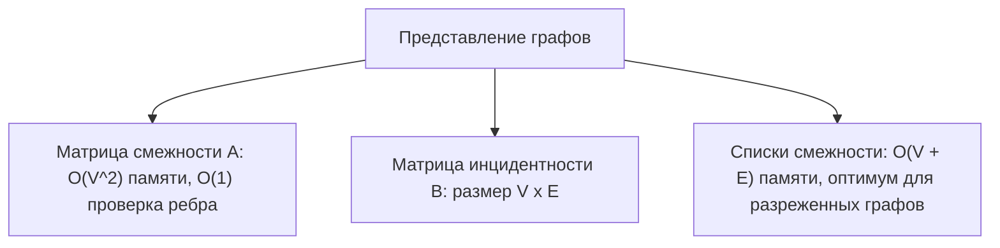
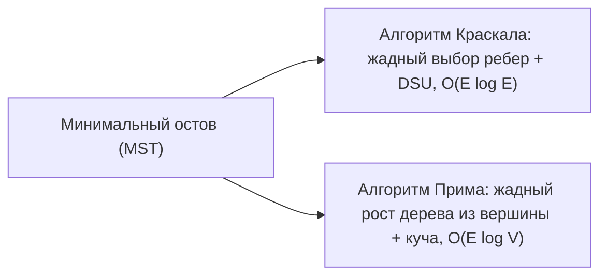

# Теория графов: связность, деревья, остовы и планарность

Конспект составлен на основе объединённых лекционных курсов дискретной математики **Пермякова А.С.** и **Страдиной М.В.**

---

## 1. Базовые понятия и классификация графов

В 1736 году Леонард Эйлер, решая задачу о кёнигсбергских мостах, положил начало теории графов.

> [!NOTE]
> **Неориентированным графом** $G = (V, E)$ называется совокупность:
> 1. Непустого множества **вершин (vertices)** $V = \{v_1, v_2, \dots, v_n\}$.
> 2. Множества **рёбер (edges)** $E$, где каждое ребро — неупорядоченная пара различных вершин: $e = \{u, v\}$.
>
> В **ориентированном графе (орграфе)** рёбра являются упорядоченными парами $(u, v) \in V \times V$ и называются **дугами**.

- **Петля (Loop):** ребро, соединяющее вершину саму с собой: $\{v, v\}$.
- **Кратные ребра:** несколько рёбер, соединяющих одну и ту же пару вершин.
- **Простой граф:** граф без петель и кратных рёбер.

---

### Степень вершины и лемма о рукопожатиях

> [!NOTE]
> **Степенью (валентностью) вершины** $\deg(v)$ называется число рёбер, инцидентных данной вершине (петля учитывается дважды).
> В орграфе различают полустепень захода $\deg^-(v)$ (число входящих дуг) и полустепень исхода $\deg^+(v)$ (число исходящих дуг).

> [!IMPORTANT]
> **Лемма о рукопожатиях (Handshaking Lemma):**
> Сумма степеней всех вершин любого графа равна удвоенному числу его рёбер:
> $$\sum_{v \in V} \deg(v) = 2 |E|$$
> *Доказательство:* Каждое ребро $e = \{u, v\}$ соединяет ровно две вершины и при суммировании степеней добавляет ровно $+1$ к $\deg(u)$ и $+1$ к $\deg(v)$, то есть суммарно $+2$.
>
> **Фундаментальное следствие:**
> В любом графе число вершин с **нечётной степенью** всегда **чётно**.

---

### Семейства специальных графов

1. **Полный граф $K_n$:** любые две вершины соединены ребром.
   $$|V| = n, \quad |E| = \binom{n}{2} = \frac{n(n - 1)}{2}, \quad \forall v: \deg(v) = n - 1$$
2. **Пустой граф $O_n$:** $n$ изолированных вершин, $|E| = 0$.
3. **Двудольный граф (Bipartite graph) $G = (V_1 \cup V_2, E)$:** множество вершин разбито на две непересекающиеся доли $V_1$ и $V_2$ так, что рёбра соединяют только вершины из разных долей.
   - Полный двудольный граф $K_{m, n}$: $|V| = m + n, \; |E| = m \cdot n$.

> [!IMPORTANT]
> **Теорема Кёнига (Критерий двудольности):**
> Граф является двудольным тогда и только тогда, когда он **не содержит простых циклов нечётной длины**.

---

## 2. Способы машинного представления графов

### Матрица смежности $A = (a_{ij})_{n \times n}$
$$a_{ij} = \begin{cases} 1, & \text{если } \{v_i, v_j\} \in E, \\ 0, & \text{иначе.} \end{cases}$$
Для неориентированного графа матрица $A$ симметрична: $A = A^T$.

> [!NOTE]
> **Теорема о степенях матрицы смежности:**
> Элемент $(A^k)_{ij}$ матрицы смежности, возведенной в степень $k$, равен **количеству маршрутов длины ровно $k$** между вершинами $v_i$ и $v_j$.

### Матрица инцидентности $B$ размера $|V| \times |E|$
- Для неориентированного графа: $b_{ie} = 1$, если вершина $v_i$ инцидентна ребру $e$, и $0$ иначе. В каждом столбце ровно две единицы.
- Для орграфа: $b_{ie} = +1$, если дуга $e$ выходит из $v_i$, $-1$, если дуга входит в $v_i$, и $0$ иначе.

---

## 3. Маршруты, цепи, циклы и связность

- **Маршрут (Walk):** последовательность чередующихся вершин и рёбер $v_0, e_1, v_1, e_2, \dots, e_k, v_k$. Длина маршрута — число рёбер $k$.
- **Цепь (Trail):** маршрут, в котором **все рёбра попарно различны**.
- **Простая цепь / Путь (Path):** маршрут, в котором **все вершины попарно различны**.
- **Цикл (Cycle):** замкнутый путь ($v_0 = v_k$, а остальные вершины различны).
- **Связность:** граф называется связным, если между любыми двумя его вершинами существует путь.
- **Компоненты связности:** максимальные по включению связные подграфы.

---

## 4. Деревья и остовы

> [!NOTE]
> **Деревом (Tree)** называется связный неориентированный граф, не содержащий циклов.
> Несвязный граф без циклов называется **лесом (Forest)** (каждая его компонента связности — дерево).

> [!IMPORTANT]
> **Теорема: 6 эквивалентных определений дерева (Пермяков А.С., Страдина М.В.):**
> Для любого графа $T = (V, E)$ с $n$ вершинами следующие утверждения равносильны:
> 1. $T$ — связный граф без циклов.
> 2. $T$ не содержит циклов и имеет ровно $|E| = n - 1$ рёбер.
> 3. $T$ связен и имеет ровно $|E| = n - 1$ рёбер.
> 4. Между любыми двумя вершинами $T$ существует **единственный простой путь**.
> 5. $T$ не содержит циклов, но добавление любого нового ребра между существующими вершинами приводит к образованию **ровно одного цикла**.
> 6. $T$ связен, но удаление любого ребра нарушает связность (каждое ребро дерева является **мостом**).

### Формула Кэли (Cayley's Formula)
Число различных помеченных деревьев на $n$ вершинах равно:
$$T_n = n^{n - 2}$$
*(Доказывается через биекцию с кодами Прюфера длины $n - 2$).*

---

## 5. Алгоритмы построения минимального остовного дерева (MST)

Пусть задан связный взвешенный граф $G = (V, E, w)$. Остовным деревом (Spanning tree) называется подграф, являющийся деревом и содержащий все вершины $V$. **Минимальным остовным деревом (MST)** называется остов с наименьшим суммарным весом рёбер.

### Алгоритм Краскала (Kruskal's Algorithm)
1. Все рёбра графа сортируются по возрастанию весов: $w(e_1) \le w(e_2) \le \dots \le w(e_m)$.
2. Остов $T$ изначально пуст.
3. Проходим по отсортированному списку рёбер. Если добавление очередного ребра $\{u, v\}$ не образует цикл с уже добавленными рёбрами, оно включается в $T$.
4. Проверка ацикличности выполняется через структуру данных **Система непересекающихся множеств (DSU / Disjoint Set Union)** за почти константное время $O(\alpha(V))$.
5. Итоговая сложность: **$O(|E| \log |E|)$**.

### Алгоритм Прима (Prim's Algorithm)
1. Начинаем с произвольной стартовой вершины $s \in V$. Множество вершин дерева $U = \{s\}$.
2. На каждом шаге выбираем ребро минимального веса $\{u, v\}$, такое что $u \in U$, а $v \notin U$.
3. Добавляем $v$ в $U$, а само ребро — в остов.
4. Повторяем до тех пор, пока $U \ne V$.
5. Итоговая сложность с двоичной кучей: **$O(|E| \log |V|)$**.

---

## 6. Эйлеровы и гамильтоновы графы

| Характеристика | Эйлеров граф | Гамильтонов граф |
| :--- | :--- | :--- |
| **Что обходится?** | **Каждое ребро** ровно один раз | **Каждая вершина** ровно один раз |
| **Критерий** | **Точный алгебраический критерий** существует | Точного простого критерия **нет** |
| **Сложность проверки** | Полиномиальная: $O(\|V\| + \|E\|)$ | **NP-полная задача** |

> [!IMPORTANT]
> **Теорема Эйлера (1736):**
> Связный граф содержит **эйлеров цикл** тогда и только тогда, когда **степени всех его вершин чётны**.
> Связный граф содержит **эйлеров путь** (открытый маршрут) тогда и только тогда, когда число вершин нечётной степени равно **$0$ или $2$** (путь начинается в одной нечётной вершине и заканчивается в другой).

### Теоремы существования гамильтонова цикла
- **Теорема Дирака (1952):** Если в простом графе с $n \ge 3$ вершинами для каждой вершины $\deg(v) \ge \frac{n}{2}$, то граф гамильтонов.
- **Теорема Оре (1960):** Если в простом графе с $n \ge 3$ вершинами для любой пары несмежных вершин $u, v$:
  $$\deg(u) + \deg(v) \ge n$$
  то граф гамильтонов.

---

## 7. Планарные графы и формула Эйлера

> [!NOTE]
> Граф $G$ называется **планарным (Planar)**, если его можно уложить на плоскости так, чтобы его рёбра пересекались только в вершинах.
> Конкретная укладка графа на плоскости называется **плоским графом**. Рёбра плоского графа разбивают плоскость на связные области — **грани (Faces)**, включая одну внешнюю бесконечную грань.

> [!IMPORTANT]
> **Формула Эйлера для плоских графов:**
> Для любого связного плоского графа с $V$ вершинами, $E$ рёбрами и $F$ гранями справедливо тождество:
> $$V - E + F = 2$$

### Необходимые условия планарности:
1. Для любого простого планарного связного графа с $V \ge 3$ вершинами:
   $$E \le 3V - 6$$
2. Если граф не содержит треугольников (например, двудольный планарный граф):
   $$E \le 2V - 4$$
3. В любом планарном графе существует хотя бы одна вершина со степенью **$\deg(v) \le 5$**.

> [!TIP]
> **Непланарность базовых графов:**
> - Для $K_5$: $V = 5, E = 10$. Но $3V - 6 = 3(5) - 6 = 9 < 10$. Противоречие $\implies K_5$ не планарен!
> - Для $K_{3,3}$: $V = 6, E = 9$. Граф двудольный (нет нечётных циклов). $2V - 4 = 2(6) - 4 = 8 < 9$. Противоречие $\implies K_{3,3}$ не планарен!

---

### Теорема Куратовского (1930)

> [!IMPORTANT]
> **Теорема Понтрягина — Куратовского:**
> Граф является планарным тогда и только тогда, когда он **не содержит подграфов, гомеоморфных $K_5$ или $K_{3,3}$** (то есть получаемых из $K_5$ или $K_{3,3}$ добавлением или удалением вершин степени 2 на рёбрах).

---

## 8. Раскраски графов

- **Правильная вершинная раскраска:** сопоставление цвета каждой вершине так, чтобы любые две смежные вершины имели разные цвета.
- **Хроматическое число $\chi(G)$:** минимальное число цветов, необходимое для правильной раскраски вершин.

> [!IMPORTANT]
> **Проблема четырех красок (Теорема Аппеля — Хакена, 1976):**
> Для любого планарного графа достаточно четырёх цветов для правильной раскраски:
> $$\chi(G_{\text{planar}}) \le 4$$
