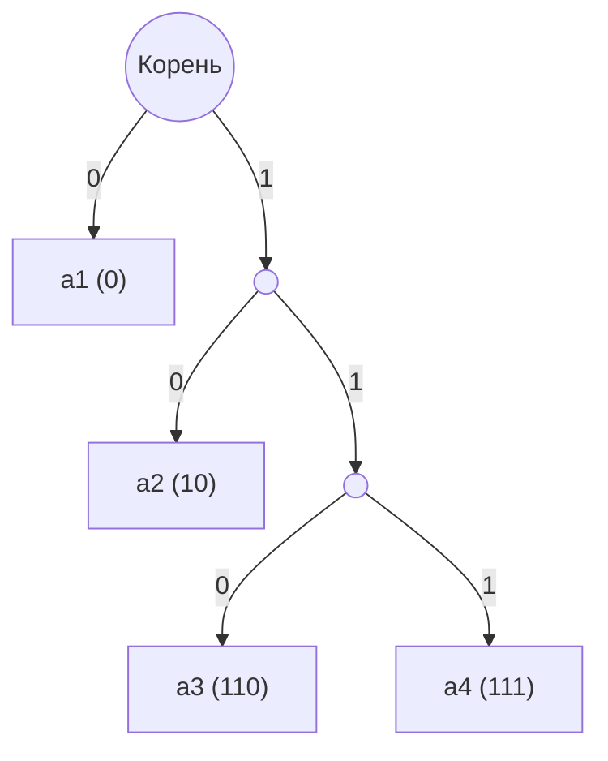
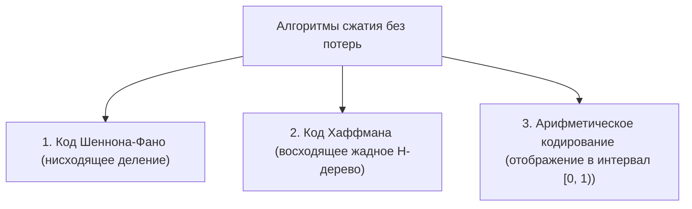

# Теория информации, энтропия Шеннона и алгоритмы сжатия

Конспект составлен на основе объединённых лекционных курсов дискретной математики **Пермякова А.С.** и **Страдиной М.В.**

---

## 1. Дискретный источник информации и энтропия Шеннона

В 1948 году Клод Шеннон опубликовал фундаментальный труд «Математическая теория связи», заложивший основы современной теории информации.

> [!NOTE]
> **Дискретным источником без памяти** называется система, порождающая последовательность символов из конечного алфавита $A = \{a_1, a_2, \dots, a_n\}$ с известным распределением вероятностей:
> $$P = \{p_1, p_2, \dots, p_n\}, \quad \sum_{i=1}^n p_i = 1, \quad p_i > 0$$

### Собственная информация события
Количество информации, содержащееся в факте наступления события с вероятностью $p_i$, обратно пропорционально его вероятности:
$$I(a_i) = \log_2 \frac{1}{p_i} = -\log_2 p_i \quad (\text{в битах / шеннонах})$$

---

### Информационная энтропия Шеннона

> [!NOTE]
> **Информационной энтропией (Shannon Entropy)** дискретного источника называется математическое ожидание количества информации, приходящегося на один передаваемый символ:
> $$H(X) = -\sum_{i=1}^n p_i \log_2 p_i$$
> При этом принимается соглашение: если $p_i = 0$, то $0 \log_2 0 = \lim_{p \to 0^+} p \log_2 p = 0$.

### Фундаментальные свойства энтропии:
1. **Неотрицательность:** $H(X) \ge 0$.
2. **Детерминированность:** $H(X) = 0$ тогда и только тогда, когда одно из событий достоверно ($p_k = 1$, а остальные равны $0$). В таком источнике нет никакой неопределённости.
3. **Максимум энтропии (Равномерное распределение):**
   $$H(X) \le \log_2 n$$
   Энтропия максимальна тогда и только тогда, когда все символы равновероятны: $p_1 = p_2 = \dots = p_n = \frac{1}{n}$. В этом случае $H(X) = \log_2 n$ (формула Хартли, 1928 г.).
4. **Субаддитивность:** для двух источников $H(X, Y) \le H(X) + H(Y)$, причем равенство достигается тогда и только тогда, когда источники статистически независимы.

---

## 2. Алфавитное кодирование и условие однозначной декодируемости

> [!NOTE]
> Пусть $A = \{a_1, \dots, a_n\}$ — исходный алфавит сообщений, а $B = \{b_1, \dots, b_d\}$ — кодирующий алфавит (при $d = 2$, $B = \{0, 1\}$ — двоичный код).
> **Схемой алфавитного кодирования** называется отображение:
> $$c: A \to B^+$$
> сопоставляющее каждому символу $a_i$ кодовое слово $c(a_i)$ длины $\ell_i = |c(a_i)|$.

Код распространяется на строки (сообщения) естественным склеиванием:
$$c(a_{i_1} a_{i_2} \dots a_{i_k}) = c(a_{i_1}) c(a_{i_2}) \dots c(a_{i_k})$$

- **Однозначно декодируемый код (Uniquely decodable code):** код, в котором любые два различных исходных сообщения отображаются в разные кодовые последовательности:
  $$\forall S_1, S_2 \in A^* \quad (S_1 \ne S_2 \implies c(S_1) \ne c(S_2))$$
- **Равномерный код (Fixed-length):** все кодовые слова имеют одинаковую длину $\ell_i = \ell = \lceil \log_d n \rceil$ (например, ASCII, UTF-32). Он всегда однозначно декодируем, но аппаратно избыточен.
- **Неравномерный код (Variable-length):** разные символы имеют разную длину кодовых слов.

### Средняя длина кодового слова и избыточность

- **Средняя длина кодового слова (Average word length):**
  $$L = \sum_{i=1}^n p_i \ell_i$$
- **Избыточность кода (Redundancy):**
  $$R = L - \frac{H(X)}{\log_2 d}$$

---

## 3. Префиксные коды и условие Фано

> [!NOTE]
> Код называется **префиксным (Prefix code)**, если никакое кодовое слово не является началом (префиксом) другого кодового слова:
> $$\forall i \ne j \quad c(a_i) \text{ не является префиксом } c(a_j)$$
> Это требование называется **условием Фано (Fano condition)**.

> [!IMPORTANT]
> **Теорема о префиксных кодах:**
> Любой префиксный код является **однозначно декодируемым**, причём декодирование происходит **мгновенно (без задержки / на лету)**: как только из входного потока считана цепочка битов, совпавшая с кодовым словом, символ немедленно восстанавливается без необходимости заглядывать вперед.

### Кодовые деревья
Префиксный код наглядно представляется в виде $d$-ичного дерева:
- Листья дерева соответствуют символам исходного алфавита.
- Путь от корня к листу определяет кодовое слово (ветвление влево — 0, вправо — 1).
- Условие Фано гарантирует, что ни одно кодовое слово не лежит на пути к другому, то есть все кодовые слова находятся **только в листьях**.

---

## 4. Неравенство Крафта — Макмиллана

Фундаментальное неравенство связывает длины кодовых слов с возможностью существования разделимого кода.

> [!IMPORTANT]
> **Теорема Крафта — Макмиллана (Kraft-McMillan Inequality):**
> Для существования однозначно декодируемого (и префиксного) кода в $d$-ичном алфавите с длинами кодовых слов $\ell_1, \ell_2, \dots, \ell_n$ **необходимо и достаточно**, чтобы выполнялось неравенство:
> $$\sum_{i=1}^n d^{-\ell_i} \le 1$$

### Первая теорема Шеннона для канала без шума

> [!NOTE]
> Для любого дискретного источника информации с энтропией $H(X)$ средняя длина кодового слова $L$ любого однозначно декодируемого $d$-ичного кода ограничена снизу:
> $$L \ge \frac{H(X)}{\log_2 d}$$
> При этом всегда существует префиксный код, удовлетворяющий неравенству:
> $$\frac{H(X)}{\log_2 d} \le L_{\text{opt}} < \frac{H(X)}{\log_2 d} + 1$$

---

## 5. Алгоритмы оптимального статистического сжатия

В лекциях Пермякова А.С. и Страдиной М.В. подробно разбираются три классических метода сжатия без потерь:

---

### 5.1. Алгоритм Шеннона — Фано (Shannon-Fano)

**Алгоритм построения «сверху вниз»:**
1. Символы алфавита упорядочиваются по убыванию вероятностей: $p_1 \ge p_2 \ge \dots \ge p_n$.
2. Список делится на две непрерывные части так, чтобы сумма вероятностей в обеих частях была **максимально близка**.
3. Символам первой группы приписывается бит `0`, второй группе — бит `1`.
4. Процедура рекурсивно повторяется для каждой подгруппы, пока в подгруппе не останется ровно один символ.

> [!WARNING]
> Алгоритм Шеннона-Фано эвристический и **не гарантирует** глобальной оптимальности средней длины кода, так как жадное разбиение на ранних этапах может приводить к неоптимальным поддеревьям.

---

### 5.2. Алгоритм Хаффмана (Huffman Coding)

В 1952 году аспирант Дэвид Хаффман создал алгоритм, строящий **доказуемо оптимальный** префиксный код.

**Алгоритм построения «снизу вверх» (Н-дерево):**
1. Создаются $n$ изолированных вершин-листьев, каждая с весом, равным вероятности $p_i$ (или частоте) символа.
2. **Жадный шаг:** Выбираются две вершины с **наименьшими весами** $p_{\min 1}$ и $p_{\min 2}$.
3. Создаётся новая родительская вершина с весом $p_{\text{parent}} = p_{\min 1} + p_{\min 2}$. Две выбранные вершины становятся её потомками (одному ребру присваивается `0`, другому — `1`).
4. Шаги 2–3 повторяются до тех пор, пока в списке не останется одна вершина — **корень дерева**.

> [!IMPORTANT]
> **Теорема Хаффмана об оптимальности:**
> Код Хаффмана имеет наименьшую среднюю длину кодового слова $L$ среди **всех возможных** префиксных кодов для заданного распределения вероятностей.

---

### 5.3. Арифметическое кодирование (Arithmetic Coding)

В то время как код Хаффмана сопоставляет каждому символу целое число битов (что неэффективно, если вероятность символа $> 0.5$, так как $\log_2(1/p) < 1$), арифметическое кодирование кодирует **всё сообщение целиком** в виде одного вещественного числа из полуинтервала $[0, 1)$.

**Алгоритм:**
1. Полуинтервал $[0, 1)$ разбивается на подинтервалы, пропорциональные вероятностям символов алфавита.
2. По мере чтения очередного символа текущий рабочий интервал $[L, R)$ сужается до соответствующего подинтервала:
   $$\text{Новая длина: } \text{Range} = R - L$$
   $$L_{\text{new}} = L + \text{Range} \cdot \mathrm{LowCum}(s)$$
   $$R_{\text{new}} = L + \text{Range} \cdot \mathrm{HighCum}(s)$$
3. Итоговое сообщение кодируется двоичной дробью минимальной длины, попадающей внутрь финального интервала.
