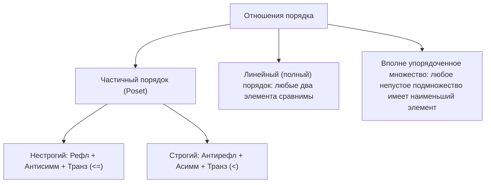
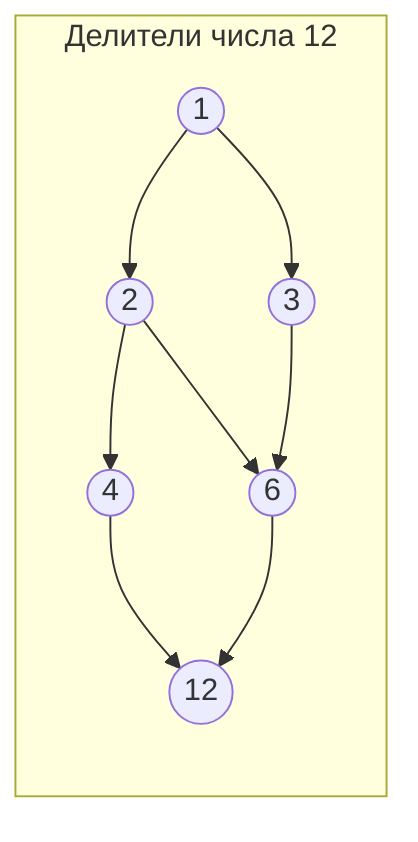
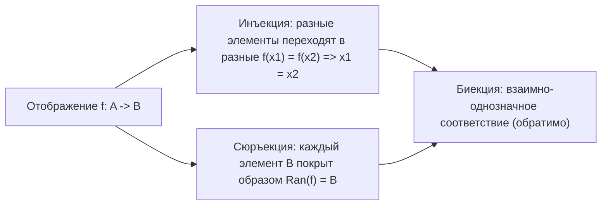

# Эквивалентность, порядки, диаграммы Хассе и решётки

Конспект составлен на основе объединённых лекционных курсов дискретной математики **Пермякова А.С.** и **Страдиной М.В.**

---

## 1. Отношение эквивалентности и разбиение множества

Одним из важнейших понятий в математике и информатике является разбиение множества объектов на классы «неразличимых» или однородных элементов.

> [!NOTE]
> Бинарное отношение $R$ на множестве $A$ называется **отношением эквивалентности** (Equivalence relation, обозначается $\sim$ или $\equiv$), если оно одновременно удовлетворяет трем аксиомам:
> 1. **Рефлексивность:** $\forall x \in A \quad (x \sim x)$
> 2. **Симметричность:** $\forall x, y \in A \quad (x \sim y \implies y \sim x)$
> 3. **Транзитивность:** $\forall x, y, z \in A \quad (x \sim y \land y \sim z \implies x \sim z)$

*Примеры:*
- Отношение равенства ($=$).
- Отношение сравнимости по модулю $m$ на $\mathbb{Z}$: $a \equiv b \pmod m \iff m \mid (a - b)$.
- Отношение подобия треугольников на плоскости.
- Отношение параллельности прямых (если прямая считается параллельной самой себе).

---

### Классы эквивалентности

> [!NOTE]
> **Классом эквивалентности** элемента $a \in A$ по отношению $\sim$ (обозначается $[a]$ или $[a]_\sim$) называется множество всех элементов множества $A$, находящихся в отношении эквивалентности с $a$:
> $$[a] = \{ x \in A \mid x \sim a \}$$
> Элемент $a$ называется **представителем** (representative) класса $[a]$.

> [!IMPORTANT]
> **Свойства классов эквивалентности (Пермяков А.С., Страдина М.В.):**
> 1. **Непустота:** Каждый класс содержит своего представителя: $\forall a \in A \; (a \in [a])$, так как $a \sim a$ по рефлексивности.
> 2. **Критерий совпадения классов:**
>    $$a \sim b \iff [a] = [b]$$
> 3. **Критерий непересекаемости:** Любые два класса эквивалентности либо полностью совпадают, либо не имеют общих элементов:
>    $$[a] \cap [b] \ne \varnothing \iff [a] = [b]$$
>    $$\neg(a \sim b) \iff [a] \cap [b] = \varnothing$$

*Доказательство свойства 3:*
Пусть $c \in [a] \cap [b]$. Тогда $c \sim a$ и $c \sim b$. В силу симметричности $a \sim c$. По транзитивности из $a \sim c$ и $c \sim b$ следует $a \sim b$. А из $a \sim b$ по свойству 2 следует $[a] = [b]$. Таким образом, если классы имеют хотя бы один общий элемент, они тождественно равны.

---

### Фактор-множество и разбиение

> [!NOTE]
> - **Фактор-множеством (Quotient set)** множества $A$ по отношению эквивалентности $\sim$ называется множество всех его классов эквивалентности:
>   $$A / \sim \; = \{ [a] \mid a \in A \}$$
> - **Разбиением (Partition)** множества $A$ называется семейство непустых попарно непересекающихся подмножеств $\{A_i\}_{i \in I}$, объединение которых дает $A$:
>   1. $\forall i \in I: A_i \ne \varnothing$
>   2. $\forall i \ne j: A_i \cap A_j = \varnothing$
>   3. $\bigcup_{i \in I} A_i = A$

> [!IMPORTANT]
> **Фундаментальная теорема об эквивалентностях и разбиениях:**
> Между множеством всех отношений эквивалентности на $A$ и множеством всех разбиений $A$ существует **взаимно-однозначное соответствие (биекция)**:
> 1. Каждое отношение эквивалентности $\sim$ порождает разбиение $A / \sim$.
> 2. Каждое разбиение $P = \{A_i\}$ порождает отношение эквивалентности:
>    $$a \sim b \iff \exists i \in I : (a \in A_i \land b \in A_i)$$

Количество всевозможных разбиений $n$-элементного множества (и соответственно число отношений эквивалентности) задается **числами Белла** $B_n$:
$$B_n = \sum_{k=1}^n \left\{ \begin{matrix} n \\ k \end{matrix} \right\}, \quad B_0 = 1, B_1 = 1, B_2 = 2, B_3 = 5, B_4 = 15, B_5 = 52$$
где $\left\{ \begin{matrix} n \\ k \end{matrix} \right\}$ — числа Стирлинга второго рода (число способов разбить $n$ элементов на $k$ непустых блоков).

---

## 2. Отношения порядка

Отношения порядка задают правила сравнимости и упорядочения элементов.

### Нестрогий частичный порядок (Poset)

> [!NOTE]
> Отношение $\le$ на множестве $P$ называется **нестрогим частичным порядком**, если оно:
> 1. **Рефлексивно:** $\forall x \in P \; (x \le x)$
> 2. **Антисимметрично:** $\forall x, y \in P \; (x \le y \land y \le x \implies x = y)$
> 3. **Транзитивно:** $\forall x, y, z \in P \; (x \le y \land y \le z \implies x \le z)$
>
> Пара $(P, \le)$ называется **частично упорядоченным множеством** (ЧУМ или *poset* — partially ordered set).

### Строгий частичный порядок

> [!NOTE]
> Отношение $<$ на множестве $P$ называется **строгим частичным порядком**, если оно:
> 1. **Антирефлексивно:** $\forall x \in P \; \neg(x < x)$
> 2. **Асимметрично:** $\forall x, y \in P \; (x < y \implies \neg(y < x))$
> 3. **Транзитивно:** $\forall x, y, z \in P \; (x < y \land y < z \implies x < z)$

Связь между строгим и нестрогим порядком:
$$x < y \iff (x \le y \land x \ne y)$$
$$x \le y \iff (x < y \lor x = y)$$

### Линейный порядок (Цепь)

> [!NOTE]
> Порядок называется **линейным (полным)**, если любые два элемента множества сравнимы:
> $$\forall x, y \in P \quad (x \le y \lor y \le x)$$
> Подмножество ЧУМ, на котором порядок линеен, называется **цепью (chain)**. Подмножество, в котором никакие два различных элемента несравнимы, называется **антицепью (antichain)**.

---

## 3. Диаграммы Хассе

Прямое изображение графа отношения порядка крайне перегружено из-за огромного числа транзитивных дуг и петель. В 1898 году немецкий математик Хельмут Хассе предложил минимальный способ визуализации конечных ЧУМ.

> [!NOTE]
> **Отношение непосредственного следования (покрытия, $\lessdot$):**
> Элемент $y$ **покрывает** элемент $x$ ($x \lessdot y$), если:
> 1. $x < y$
> 2. Не существует такого промежуточного элемента $z$, что $x < z < y$.

### Правила построения диаграммы Хассе:
1. Удаляются все петли (они подразумеваются по рефлексивности).
2. Удаляются все транзитивные ребра (если есть ребра $a \to b$ и $b \to c$, то прямое ребро $a \to c$ не проводится).
3. Если $x \lessdot y$, то вершина $y$ рисуется **строго выше** вершины $x$, и между ними проводится ненаправленный отрезок.
4. Элемент $a \le b$ тогда и только тогда, когда от вершины $a$ к вершине $b$ можно подняться вверх по отрезкам диаграммы.

---

## 4. Экстремальные элементы частично упорядоченного множества

Пусть $(P, \le)$ — ЧУМ, и $S \subseteq P$. В лекциях Страдиной М.В. и Пермякова А.С. подчеркивается принципиальная разница между понятиями «наименьший/наибольший» и «минимальный/максимальный»:

| Экстремум | Строгое математическое определение | Единственность |
| :--- | :--- | :--- |
| **Наименьший (Least)** | $m \in S: \forall x \in S \quad (m \le x)$ | **Единственен** (если существует) |
| **Наибольший (Greatest)** | $M \in S: \forall x \in S \quad (x \le M)$ | **Единственен** (если существует) |
| **Минимальный (Minimal)** | $m \in S: \neg \exists x \in S \quad (x < m)$ | Может быть **несколько** |
| **Максимальный (Maximal)** | $M \in S: \neg \exists x \in S \quad (M < x)$ | Может быть **несколько** |

> [!IMPORTANT]
> **Теорема о единственности наибольшего (наименьшего) элемента:**
> Если в множестве $S$ существует наибольший (наименьший) элемент, то он единственен.
> *Доказательство:*
> Пусть $M_1$ и $M_2$ — два наибольших элемента в $S$.
> Так как $M_1$ наибольший, а $M_2 \in S$, то $M_2 \le M_1$.
> Так как $M_2$ наибольший, а $M_1 \in S$, то $M_1 \le M_2$.
> По антисимметричности порядка: $M_1 \le M_2 \land M_2 \le M_1 \implies M_1 = M_2$.

### Грани подмножеств: Инфимум и Супремум

Пусть $S \subseteq P$:
- **Нижняя грань (миноранта):** элемент $x \in P$, такой что $\forall s \in S \; (x \le s)$.
- **Верхняя грань (мажоранта):** элемент $y \in P$, такой что $\forall s \in S \; (s \le y)$.
- **Инфимум ($\inf S$ / точная нижняя грань):** наибольшая среди всех нижних граней множества $S$.
- **Супремум ($\sup S$ / точная верхняя грань):** наименьшая среди всех верхних граней множества $S$.

> [!TIP]
> В отличие от минимума и максимума, $\inf S$ и $\sup S$ **не обязаны принадлежать** самому подмножеству $S$.

---

## 5. Решётки (Lattices)

> [!NOTE]
> Частично упорядоченное множество $(L, \le)$ называется **решёткой (структурой)**, если для любых двух элементов $a, b \in L$ существуют:
> 1. Точная нижняя грань (meet): $a \land b = \inf(a, b)$.
> 2. Точная верхняя грань (join): $a \lor b = \sup(a, b)$.

### Алгебраическое определение решётки

Алгебраическая система $(L, \lor, \land)$ с двумя бинарными операциями называется решёткой, если для любых $a, b, c \in L$ выполнены тождества:
1. **Коммутативность:**
   $$a \lor b = b \lor a, \quad a \land b = b \land a$$
2. **Ассоциативность:**
   $$(a \lor b) \lor c = a \lor (b \lor c), \quad (a \land b) \land c = a \land (b \land c)$$
3. **Идемпотентность:**
   $$a \lor a = a, \quad a \land a = a$$
4. **Законы поглощения (Absorption laws):**
   $$a \lor (a \land b) = a, \quad a \land (a \lor b) = a$$

Порядок задается через операции формулой:
$$a \le b \iff a \land b = a \iff a \lor b = b$$

### Специальные классы решёток

- **Дистрибутивная решётка:** выполняются законы дистрибутивности:
  $$a \land (b \lor c) = (a \land b) \lor (a \land c)$$
  $$a \lor (b \land c) = (a \lor b) \land (a \lor c)$$
- **Решётка с дополнениями:** решётка ограничена (имеет 0 и 1), и для каждого $a \in L$ существует дополнение $a'$ такое, что $a \land a' = 0$ и $a \lor a' = 1$.
- **Булева алгебра:** любая **дистрибутивная решётка с дополнениями**.

---

## 6. Функции и отображения

В лекциях Пермякова А.С. и Страдиной М.В. отображение (функция) определяется как специальный вид бинарного отношения.

> [!NOTE]
> Бинарное отношение $f \subseteq A \times B$ называется **функциональным отношением (отображением / функцией)** из $A$ в $B$ (обозначается $f: A \to B$), если каждый элемент множества $A$ связан **не более чем с одним** элементом множества $B$:
> $$\forall x \in A, \; y_1, y_2 \in B \quad ((x, y_1) \in f \land (x, y_2) \in f \implies y_1 = y_2)$$

- **Всюду определенная функция:** $\mathrm{Dom}(f) = A$.
- **Частичная функция:** $\mathrm{Dom}(f) \subset A$.

### Классификация отображений

1. **Инъекция (вложение / одно-однозначное отображение):**
   $$\forall x_1, x_2 \in A \quad (x_1 \ne x_2 \implies f(x_1) \ne f(x_2))$$
   $$\iff f(x_1) = f(x_2) \implies x_1 = x_2$$
   - *Для конечных множеств:* существование инъекции $f: A \to B$ влечет $|A| \le |B|$.
2. **Сюръекция («на»):**
   $$\forall y \in B \quad \exists x \in A : f(x) = y \quad (\mathrm{Ran}(f) = B)$$
   - *Для конечных множеств:* существование сюръекции $f: A \to B$ влечет $|A| \ge |B|$.
3. **Биекция (взаимно-однозначное соответствие):**
   Отображение, одновременно являющееся **инъективным и сюръективным**.
   - *Для конечных множеств:* существование биекции возможно тогда и только тогда, когда $|A| = |B|$.
   - Обратное отношение $f^{-1}$ является функцией **тогда и только тогда, когда $f$ — биекция**.
