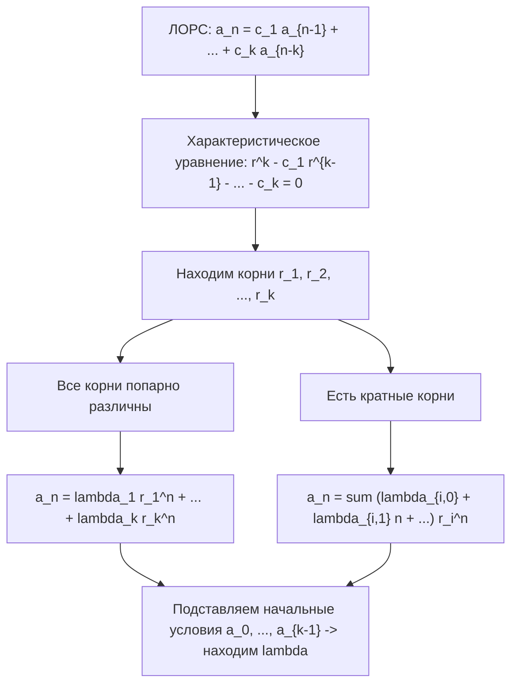
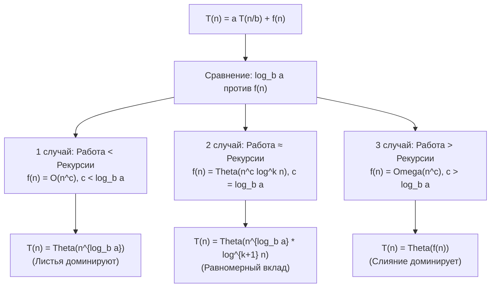

# Рекуррентные соотношения и Мастер-теорема

Конспект составлен строго на основе объединённых лекций по дискретной математике **Страдиной М.В.** (Лекция 6 «Рекуррентные соотношения») и **Пермякова А.С.** (Лекция «Мастер-теорема»).

---

## 1. Понятие рекуррентного соотношения

В программировании и анализе алгоритмов многие задачи (сортировки, обходы деревьев, динамическое программирование) описываются рекурсивно — сведением задачи размера $n$ к подзадачам меньшего размера.

> [!NOTE]
> **Рекуррентная формула (Recurrence relation)** порядка $p$ — это соотношение вида:
> $$a_n = f(n, a_{n-1}, a_{n-2}, \dots, a_{n-p})$$
> выражающее каждый следующий член последовательности $a_n$ через $p$ предыдущих членов и номер $n$, вместе с заданными первыми $p$ начальными условиями:
> $$a_0, a_1, \dots, a_{p-1}$$
> Число $p$ называется **порядком** рекуррентного соотношения.

**Решить рекуррентное соотношение** — значит получить для $a_n$ выражение в **замкнутой форме (closed formula)**, то есть явную функцию от номера $n$, не содержащую обращений к самой последовательности.

### Примеры базовых методов решения

#### Пример 1: Метод подбора (анзац) для арифметической прогрессии
Рекуррентное соотношение:
$$a_n = \begin{cases} a_0 = \text{const}, & \text{если } n = 0 \\ a_{n-1} + d, & \text{если } n > 0 \end{cases}$$
- Предполагаем замкнутую формулу: $a_n = a_0 + n \cdot d$.
- Проверка подстановкой:
  $$a_n = a_{n-1} + d = (a_0 + (n-1)d) + d = a_0 + nd \quad \blacksquare$$

#### Пример 2: Итеративный метод (развёртывание)
Рекуррентное соотношение:
$$\begin{cases} a_0 = 3 \\ a_n = 2a_{n-1} - 1 \end{cases}$$
Последовательно подставляем предыдущие члены:
$$a_n = 2a_{n-1} - 1 = 2(2a_{n-2} - 1) - 1 = 2^2 a_{n-2} - 2^1 - 2^0$$
$$= 2^2(2a_{n-3} - 1) - 2^1 - 2^0 = 2^3 a_{n-3} - 2^2 - 2^1 - 2^0 = \dots$$
$$= 2^n a_0 - \left( 2^{n-1} + 2^{n-2} + \dots + 2^1 + 2^0 \right)$$
Сумма геометрической прогрессии:
$$\sum_{i=0}^{n-1} 2^i = \frac{2^n - 1}{2 - 1} = 2^n - 1$$
Подставляем начальное значение $a_0 = 3$:
$$a_n = 2^n \cdot 3 - (2^n - 1) = 3 \cdot 2^n - 2^n + 1 = 2 \cdot 2^n + 1 = \mathbf{2^{n+1} + 1}$$

### Классификация рекуррентных соотношений
- $b_n = 2.71 b_{n-1}$ — линейное однородное порядка 1;
- $F_n = F_{n-1} + F_{n-2}$ — линейное однородное порядка 2 (числа Фибоначчи);
- $g_n = 2 g_{n-5}$ — линейное однородное порядка 5;
- $a_n = a_{n-1} + a_{n-2}^2$ — **нелинейное** (из-за квадрата $a_{n-2}^2$);
- $H_n = 2H_{n-1} + 1$ — **неоднородное** (из-за свободного слагаемого $+1$);
- $B_n = n B_{n-1}$ — **с переменными коэффициентами** (коэффициент зависит от $n$).

---

## 2. Линейные однородные рекуррентные соотношения (ЛОРС)

> [!NOTE]
> Последовательность $(a_n)$ удовлетворяет **линейному однородному рекуррентному соотношению (ЛОРС) порядка $k$**, если для всех $n \ge k$:
> $$a_n = c_1 a_{n-1} + c_2 a_{n-2} + \dots + c_k a_{n-k}$$
> где $c_i \in \mathbb{R}$ — постоянные коэффициенты, причём $c_k \ne 0$.
>
> Эквивалентная форма записи со сдвигом индексов:
> $$a_{n+k} = c_1 a_{n+k-1} + c_2 a_{n+k-2} + \dots + c_k a_n$$
> Последовательность $(a_n)$, являющаяся решением такого уравнения, называется **возвратной последовательностью порядка $k$**.

### Характеристическое уравнение

Перенесём все члены рекуррентного соотношения в левую часть:
$$a_n - c_1 a_{n-1} - c_2 a_{n-2} - \dots - c_k a_{n-k} = 0$$
Ищем решение в виде геометрической прогрессии $a_n = r^n$ ($r \ne 0$). Подставляя $a_n = r^n$ и деля обе части на $r^{n-k}$, получаем:

> [!IMPORTANT]
> **Характеристическое уравнение:**
> $$r^k - c_1 r^{k-1} - c_2 r^{k-2} - \dots - c_k = 0$$

По основной теореме алгебры многочлен степени $k$ имеет ровно $k$ комплексных корней (с учётом их кратностей).

---

### Теорема о корнях характеристического уравнения

#### Случай 1: Все корни простые (попарно различные)
Если характеристическое уравнение порядка $k$ имеет $k$ различных корней $r_1, r_2, \dots, r_k$, то общее решение имеет вид:
$$a_n = \lambda_1 r_1^n + \lambda_2 r_2^n + \dots + \lambda_k r_k^n$$
где константы $\lambda_1, \dots, \lambda_k$ однозначно определяются из системы начальных условий.

#### Пример 4 (из лекции Страдиной М.В.):
Найти последовательность $(a_n)$, если:
$$a_n - 4a_{n-1} + 3a_{n-2} = 0, \quad a_0 = 10, \quad a_1 = 16$$
1. Характеристическое уравнение:
   $$r^2 - 4r + 3 = 0 \implies (r - 1)(r - 3) = 0 \implies r_1 = 1, \quad r_2 = 3$$
2. Общее решение:
   $$a_n = \lambda_1 \cdot 1^n + \lambda_2 \cdot 3^n = \lambda_1 + \lambda_2 \cdot 3^n$$
3. Начальные условия:
   $$\begin{cases} a_0 = \lambda_1 + \lambda_2 = 10 \\ a_1 = \lambda_1 + 3\lambda_2 = 16 \end{cases} \implies 2\lambda_2 = 6 \implies \lambda_2 = 3, \quad \lambda_1 = 7$$
4. Ответ:
   $$a_n = 7 \cdot 1^n + 3 \cdot 3^n = \mathbf{7 + 3^{n+1}}$$

#### Пример 5: Числа Фибоначчи и Формула Бине
$$F_n = F_{n-1} + F_{n-2}, \quad F_0 = 0, \quad F_1 = 1$$
1. Характеристическое уравнение:
   $$r^2 - r - 1 = 0 \implies r_{1, 2} = \frac{1 \pm \sqrt{5}}{2}$$
2. Общее решение:
   $$F_n = \lambda_1 \left( \frac{1 + \sqrt{5}}{2} \right)^n + \lambda_2 \left( \frac{1 - \sqrt{5}}{2} \right)^n$$
3. Система для начальных условий:
   $$\begin{cases} F_0 = \lambda_1 + \lambda_2 = 0 \implies \lambda_2 = -\lambda_1 \\ F_1 = \lambda_1 \left( \frac{1+\sqrt{5}}{2} \right) + \lambda_2 \left( \frac{1-\sqrt{5}}{2} \right) = \lambda_1 \sqrt{5} = 1 \implies \lambda_1 = \frac{1}{\sqrt{5}}, \quad \lambda_2 = -\frac{1}{\sqrt{5}} \end{cases}$$
4. Знаменитая **формула Бине**:
   $$F_n = \frac{1}{\sqrt{5}} \left[ \left( \frac{1 + \sqrt{5}}{2} \right)^n - \left( \frac{1 - \sqrt{5}}{2} \right)^n \right]$$

#### Пример из лекции Пермякова А.С.:
$$a_n = a_{n-1} + 6a_{n-2}, \quad a_0 = 1, \quad a_1 = 8$$
1. Характеристическое уравнение:
   $$r^2 - r - 6 = 0 \implies (r - 3)(r + 2) = 0 \implies r_1 = -2, \quad r_2 = 3$$
2. Общее решение:
   $$a_n = \lambda_1 (-2)^n + \lambda_2 \cdot 3^n$$
3. Начальные условия:
   $$\begin{cases} a_0 = \lambda_1 + \lambda_2 = 1 \\ a_1 = -2\lambda_1 + 3\lambda_2 = 8 \end{cases} \implies 5\lambda_2 = 10 \implies \lambda_2 = 2, \quad \lambda_1 = -1$$
4. Ответ:
   $$a_n = -(-2)^n + 2 \cdot 3^n$$

---

### Случай 2: Кратные корни характеристического уравнения

> [!NOTE]
> Если характеристическое уравнение имеет корень $r_0$ кратности 2, то общее решение имеет вид:
> $$a_n = (\lambda_1 + \lambda_2 n) \cdot r_0^n$$
> В общем случае, если уравнение имеет $q$ различных корней $r_1, \dots, r_q$ с кратностями $m_1, \dots, m_q$ ($\sum_{i=1}^q m_i = k$), то общее решение:
> $$a_n = \sum_{i=1}^q r_i^n \cdot \left( \sum_{j=0}^{m_i - 1} \lambda_{i, j} \cdot n^j \right)$$

#### Пример 6 (из лекции Страдиной М.В.):
$$a_n = 6a_{n-1} - 9a_{n-2}, \quad a_0 = 6, \quad a_1 = 6$$
1. Характеристическое уравнение:
   $$r^2 - 6r + 9 = 0 \implies (r - 3)^2 = 0 \implies r_1 = r_2 = 3 \quad (m = 2)$$
2. Общее решение:
   $$a_n = (\lambda_1 + \lambda_2 n) \cdot 3^n$$
3. Начальные условия:
   $$\begin{cases} a_0 = (\lambda_1 + 0) \cdot 3^0 = \lambda_1 = 6 \\ a_1 = (\lambda_1 + \lambda_2) \cdot 3^1 = 6 \implies (\lambda_1 + \lambda_2) \cdot 3 = 6 \implies 6 + \lambda_2 = 2 \implies \lambda_2 = -4 \end{cases}$$
4. Итоговое решение:
   $$a_n = \mathbf{(6 - 4n) \cdot 3^n}$$

#### Пример 7 (корень кратности 2 и корень кратности 1):
$$a_n = 7a_{n-1} - 16a_{n-2} + 12a_{n-3}$$
1. Характеристическое уравнение:
   $$r^3 - 7r^2 + 16r - 12 = 0 \implies (r - 2)^2 (r - 3) = 0$$
   Корни: $r_1 = 2$ кратности $m_1 = 2$, $r_2 = 3$ кратности $m_2 = 1$.
2. Общее решение:
   $$a_n = (\lambda_{1, 0} + \lambda_{1, 1} n) \cdot 2^n + \lambda_{2, 0} \cdot 3^n$$

---

## 3. Линейные неоднородные рекуррентные соотношения (ЛНРС)

> [!NOTE]
> **Линейным неоднородным рекуррентным соотношением (ЛНРС)** порядка $k$ называется уравнение вида:
> $$a_n = c_1 a_{n-1} + c_2 a_{n-2} + \dots + c_k a_{n-k} + F(n)$$
> где $F(n) \not\equiv 0$ — правая часть (функция неоднородности).

> [!IMPORTANT]
> **Теорема о структуре общего решения ЛНРС (Th1):**
> Пусть $a_n^{(h)}$ — общее решение соответствующего однородного уравнения (при $F(n) = 0$), а $a_n^{(p)}$ — некоторое частное решение неоднородного уравнения. Тогда общее решение неоднородного соотношения задаётся формулой:
> $$a_n = a_n^{(h)} + a_n^{(p)}$$

### Метод неопределённых коэффициентов

#### Пример 8: Многочленная правая часть
$$a_n = 3a_{n-1} + 2n$$
- **Этап I (Однородное уравнение):**
  $$a_n - 3a_{n-1} = 0 \implies r - 3 = 0 \implies r_1 = 3 \implies a_n^{(h)} = \lambda \cdot 3^n$$
- **Этап II (Частное решение):**
  Функция $F(n) = 2n$ — многочлен 1-й степени. Ищем частное решение в виде линейной функции $p_n = cn + d$:
  $$cn + d = 3(c(n - 1) + d) + 2n$$
  $$cn + d = 3cn - 3c + 3d + 2n = (3c + 2)n + (3d - 3c)$$
  Приравниваем коэффициенты при одинаковых степенях $n$:
  $$\begin{cases} c = 3c + 2 \implies 2c = -2 \implies c = -1 \\ d = 3d - 3c \implies 2d = 3c = -3 \implies d = -3/2 \end{cases}$$
  Частное решение: $a_n^{(p)} = -n - 3/2$.
- **Этап III (Итоговое решение):**
  $$a_n = a_n^{(h)} + a_n^{(p)} = \mathbf{-n - \frac{3}{2} + \lambda \cdot 3^n}$$

---

#### Пример 9: Резонансный случай (экспоненциальная часть совпадает с корнем)
$$a_{n+2} - 4a_{n+1} + 3a_n = n 3^n$$
- **Этап I (Однородное уравнение):**
  $$r^2 - 4r + 3 = 0 \implies r_1 = 1, \quad r_2 = 3$$
  $$a_n^{(h)} = \lambda_1 \cdot 1^n + \lambda_2 \cdot 3^n$$
- **Этап II (Частное решение с резонансом):**
  Правая часть $F(n) = n 3^n$ является произведением многочлена 1-й степени на экспоненту $3^n$.
  **Внимание:** основание $3$ уже является корнем характеристического уравнения кратности 1!
  Поэтому частное решение умножается на $n^1$:
  $$a_n^{(p)} = (cn + d) \cdot 3^n \cdot n^1 = (cn^2 + dn) \cdot 3^n$$
  Подставляем в исходное уравнение:
  $$a_{n+2}^{(p)} - 4a_{n+1}^{(p)} + 3a_n^{(p)} = n 3^n$$
  $$\left( c(n+2)^2 + d(n+2) \right) 3^{n+2} - 4 \left( c(n+1)^2 + d(n+1) \right) 3^{n+1} + 3 \left( cn^2 + dn \right) 3^n = n 3^n$$
  Делим обе части на $3^n$:
  $$9(cn^2 + 4cn + 4c + dn + 2d) - 12(cn^2 + 2cn + c + dn + d) + 3(cn^2 + dn) = n$$
  Приводим подобные члены:
  - При $n^2$: $9c - 12c + 3c = 0$ (сократилось, как и должно быть при резонансе);
  - При $n$: $36c + 9d - 24c - 12d + 3d = 12c$;
  - Свободный член: $36c + 18d - 12c - 12d = 24c + 6d$.
  Получаем равенство многочленов:
  $$12c \cdot n + (24c + 6d) = n$$
  $$\begin{cases} 12c = 1 \implies c = \frac{1}{12} \\ 24c + 6d = 0 \implies 2 + 6d = 0 \implies d = -\frac{1}{6} \end{cases}$$
  Частное решение:
  $$a_n^{(p)} = \left( \frac{1}{12} n^2 - \frac{1}{6} n \right) 3^n = \frac{(n^2 - 2n) 3^n}{12} = \mathbf{\frac{(n^2 - 2n) 3^{n-1}}{4}}$$
- **Итоговое общее решение:**
  $$a_n = \lambda_1 \cdot 1^n + \lambda_2 \cdot 3^n + \frac{(n^2 - 2n) 3^{n-1}}{4}$$

---

## 4. Асимптотический анализ алгоритмов

В лекции Пермякова А.С. анализируется время работы рекурсивных алгоритмов «Разделяй и властвуй» (Divide and Conquer).

### Определения асимптотических оценок
- $T(n) \in O(g(n)) \iff \exists c > 0, \, n_0: \; \forall n \ge n_0 \; |T(n)| \le c \cdot |g(n)|$ (асимптотическая верхняя граница).
- $T(n) \in \Omega(g(n)) \iff \exists c > 0, \, n_0: \; \forall n \ge n_0 \; |T(n)| \ge c \cdot |g(n)|$ (асимптотическая нижняя граница).
- $T(n) \in \Theta(g(n)) \iff T(n) \in O(g(n)) \land T(n) \in \Omega(g(n))$ (асимптотически точная оценка).

### Предельные критерии
$$\lim_{n \to \infty} \frac{f(n)}{g(n)} = c \ne 0, \infty \implies f \in \Theta(g)$$
$$\lim_{n \to \infty} \frac{f(n)}{g(n)} = 0 \implies f \in o(g) \quad (f \text{ растёт медленнее } g)$$
$$\lim_{n \to \infty} \frac{f(n)}{g(n)} = \infty \implies f \in \omega(g) \quad (f \text{ растёт быстрее } g)$$

---

## 5. Мастер-теорема (Основная теорема)

Мастер-теорема (Master Theorem) — ключевой инструмент для быстрого нахождения асимптотической сложности рекуррентных соотношений вида:
$$T(n) = a \cdot T\left(\frac{n}{b}\right) + f(n)$$
где:
- $n$ — размер задачи;
- $a \ge 1$ — количество рекурсивных вызовов (подзадач);
- $n/b$ ($b > 1$) — размер каждой подзадачи;
- $f(n)$ — стоимость разделения задачи и объединения результатов.

### Суть теоремы: Баланс между рекурсией и слиянием
Дерево рекурсии имеет глубину $\log_b n$. На самом глубоком уровне находится $a^{\log_b n} = n^{\log_b a}$ листьев.
Вводится **критический показатель**:
$$c_{\text{crit}} = \log_b a$$
Сравнивается скорость роста стоимости работы на листьях $n^{\log_b a}$ и функции слияния $f(n)$:

---

### Три случая Мастер-теоремы с примерами из лекций

#### Случай 1: Работа на листьях больше работы на слиянии (Работа < Рекурсии)
Если $f(n) = O(n^c)$, где $c < \log_b a$:
$$T(n) = \mathbf{\Theta\left(n^{\log_b a}\right)}$$
**Пример из лекции:**
$$T(n) = 8T\left(\frac{n}{2}\right) + 1000n^2$$
- $a = 8, \; b = 2, \; f(n) = 1000n^2 \implies c = 2$.
- $\log_b a = \log_2 8 = 3$.
- Так как $c = 2 < 3 = \log_b a$, доминирует рекурсия:
  $$T(n) = \Theta(n^{\log_2 8}) = \mathbf{\Theta(n^3)}$$

---

#### Случай 2: Баланс между работой на слиянии и рекурсией (Работа $\approx$ Рекурсии)
Если $f(n) = \Theta(n^c \log^k n)$ при $k \ge 0$, где $c = \log_b a$:
$$T(n) = \mathbf{\Theta\left(n^c \log^{k+1} n\right)}$$
**Пример из лекции:**
$$T(n) = 2T\left(\frac{n}{2}\right) + 10n$$
- $a = 2, \; b = 2, \; f(n) = 10n \implies c = 1, \; k = 0$.
- $\log_b a = \log_2 2 = 1 = c$.
- Получаем:
  $$T(n) = \Theta(n^1 \log^{0+1} n) = \mathbf{\Theta(n \log n)}$$

**Классический пример: Сортировка слиянием (MergeSort):**
$$T(n) = 2T\left(\frac{n}{2}\right) + O(n) \implies T(n) = \mathbf{\Theta(n \log n)}$$

---

#### Случай 3: Работа на слиянии больше работы на листьях (Работа > Рекурсии)
Если $f(n) = \Omega(n^c)$, где $c > \log_b a$, и выполняется **условие регулярности**:
$$a \cdot f\left(\frac{n}{b}\right) \le k \cdot f(n) \quad \text{для некоторой константы } k < 1 \text{ при больших } n$$
Тогда:
$$T(n) = \mathbf{\Theta(f(n))}$$
**Пример из лекции:**
$$T(n) = 2T\left(\frac{n}{2}\right) + n^2$$
- $a = 2, \; b = 2, \; f(n) = n^2 \implies c = 2$.
- $\log_b a = \log_2 2 = 1 < 2 = c$.
- Проверяем условие регулярности:
  $$2 \cdot f\left(\frac{n}{2}\right) = 2 \cdot \left(\frac{n}{2}\right)^2 = 2 \cdot \frac{n^2}{4} = \frac{1}{2} n^2 \le k \cdot n^2 \quad \text{при } k = \frac{1}{2} < 1$$
- Условие выполнено, доминирует функция слияния:
  $$T(n) = \mathbf{\Theta(n^2)}$$

---

> [!NOTE]
> **Ограничение классической Мастер-теоремы:**
> Мастер-теорема применима только при одинаковом делении подзадач ($n/b$). Если ветви рекурсии делятся неравномерно (например, $T(n) = T(n/3) + T(2n/3) + n$), классическая теорема неприменима (для таких несимметричных случаев на слайде 43 лекции упоминается обобщённый метод Акра-Баззи через характеристический интеграл).
