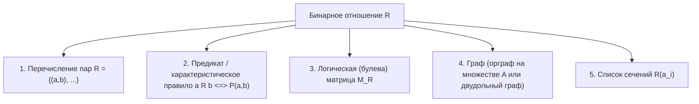

# Бинарные отношения: фундаментальные основы и операции

Конспект составлен на основе объединённых лекционных курсов дискретной математики **Пермякова А.С.** и **Страдиной М.В.**

---

## 1. Декартово произведение множеств

Математическим фундаментом теории отношений служит операция прямого (декартова) произведения.

> [!NOTE]
> **Декартовым (прямым) произведением** двух множеств $A$ и $B$ (обозначается $A \times B$) называется множество всех упорядоченных пар $(a, b)$, в которых первый элемент принадлежит множеству $A$, а второй — множеству $B$:
> $$A \times B = \{ (a, b) \mid a \in A \land b \in B \}$$

Для произвольного конечного числа множеств $A_1, A_2, \dots, A_n$ декартово произведение определяется как множество упорядоченных $n$-ок (кортежей длины $n$):
$$A_1 \times A_2 \times \dots \times A_n = \{ (a_1, a_2, \dots, a_n) \mid a_i \in A_i, \; i = 1, 2, \dots, n \}$$

Если все перемножаемые множества совпадают ($A_1 = A_2 = \dots = A_n = A$), произведение называется **декартовой степенью** и обозначается $A^n$:
$$A^2 = A \times A, \quad A^3 = A \times A \times A, \quad \dots, \quad A^n = \underbrace{A \times A \times \dots \times A}_{n}$$

### Мощность декартова произведения

Для конечных множеств $A$ и $B$:
$$|A \times B| = |A| \cdot |B|$$
В общем случае для $n$ множеств:
$$|A_1 \times A_2 \times \dots \times A_n| = \prod_{i=1}^n |A_i|$$

> [!TIP]
> **Пример:** Пусть $A = \{1, 2, 3\}$, $B = \{a, b\}$. Тогда:
> $$A \times B = \{(1, a), (1, b), (2, a), (2, b), (3, a), (3, b)\}, \quad |A \times B| = 3 \cdot 2 = 6$$

### Алгебраические свойства декартова произведения

1. **Некоммутативность в общем случае:**
   $$A \times B \ne B \times A \quad (\text{если } A \ne B \text{ и } A \ne \varnothing, B \ne \varnothing)$$
   *Исключения:* $A \times B = B \times A \iff A = B$ либо $A = \varnothing$, либо $B = \varnothing$.
2. **Свойство пустого множества:**
   $$A \times \varnothing = \varnothing \times A = \varnothing$$
3. **Квазиассоциативность:**
   Строго говоря, $(A \times B) \times C \ne A \times (B \times C)$, так как элементы первого множества имеют вид $((a, b), c)$, а второго — $(a, (b, c))$. Однако между ними существует естественный изоморфизм (каноническая биекция) $((a, b), c) \mapsto (a, b, c)$, поэтому на практике скобки опускают и пишут $A \times B \times C$.
4. **Дистрибутивность относительно теоретико-множественных операций:**
   - Относительно объединения:
     $$A \times (B \cup C) = (A \times B) \cup (A \times C)$$
     $$(A \cup B) \times C = (A \times C) \cup (B \times C)$$
   - Относительно пересечения:
     $$A \times (B \cap C) = (A \times B) \cap (A \times C)$$
     $$(A \cap B) \times C = (A \times C) \cap (B \times C)$$
   - Относительно разности:
     $$A \times (B \setminus C) = (A \times B) \setminus (A \times C)$$
     $$(A \setminus B) \times C = (A \times C) \setminus (B \times C)$$

---

## 2. Определение бинарного отношения

> [!NOTE]
> **Бинарным отношением** $R$ между множествами $A$ и $B$ называется любое подмножество их декартова произведения:
> $$R \subseteq A \times B$$
> Множество всех возможных бинарных отношений между $A$ и $B$ совпадает с булеаном $\mathcal{P}(A \times B)$.

- Если $(a, b) \in R$, то говорят: «элемент $a$ находится в отношении $R$ с элементом $b$» и используют инфиксную запись:
  $$a \, R \, b \iff (a, b) \in R$$
- Если пара не входит в отношение:
  $$a \mathrel{\not R} b \iff (a, b) \notin R$$
- Если $A = B$, отношение $R \subseteq A \times A = A^2$ называется **бинарным отношением на множестве $A$** (или *однородным отношением*).

### Количество бинарных отношений

Для конечных множеств с мощностями $|A| = m$ и $|B| = n$:
- Число элементов в декартовом произведении равно $|A \times B| = m \cdot n$.
- Следовательно, число всевозможных бинарных отношений между $A$ и $B$ равно мощности булеана:
  $$|\mathcal{P}(A \times B)| = 2^{|A \times B|} = 2^{m \cdot n}$$
- Для отношения на одном множестве мощности $|A| = n$:
  $$N_{\text{всех}} = 2^{n^2}$$

> [!NOTE]
> **Примеры экстремальных отношений:**
> 1. **Пустое отношение** $\varnothing \subseteq A \times B$: ни одна пара не связана ($\forall a \in A, b \in B: a \mathrel{\not R} b$).
> 2. **Универсальное (полное) отношение** $U = A \times B$: любые два элемента связаны ($a \, U \, b$ для всех $a, b$).
> 3. **Отношение равенства (диагональ)** $I_A$ (или $\mathrm{id}_A$, $\Delta_A$) на множестве $A$:
>    $$I_A = \{ (a, a) \mid a \in A \}$$

---

## 3. Области и сечения бинарного отношения

Пусть $R \subseteq A \times B$.

### Область определения и область значений

> [!NOTE]
> - **Область определения (Domain):** множество всех первых элементов пар, входящих в отношение:
>   $$\mathrm{Dom}(R) = \{ a \in A \mid \exists b \in B: (a, b) \in R \} \subseteq A$$
> - **Область значений / образ (Range / Codomain / Image):** множество всех вторых элементов пар:
>   $$\mathrm{Ran}(R) = \{ b \in B \mid \exists a \in A: (a, b) \in R \} \subseteq B$$
> - **Поле отношения (Field):** объединение области определения и области значений:
>   $$\mathrm{Fld}(R) = \mathrm{Dom}(R) \cup \mathrm{Ran}(R)$$

### Сечения (срезы) отношения

В лекциях Пермякова А.С. и Страдиной М.В. подробно разбирается понятие сечений:
- **Верхнее (правое) сечение** отношения по элементу $a \in A$ — множество всех элементов $b \in B$, с которыми связан $a$:
  $$R(a) = \{ b \in B \mid (a, b) \in R \}$$
- **Нижнее (левое) сечение** отношения по элементу $b \in B$ — множество всех элементов $a \in A$, которые связаны с $b$:
  $$R^{-1}(b) = \{ a \in A \mid (a, b) \in R \}$$

Для подмножества $X \subseteq A$ сечение (полный образ множества) определяется как:
$$R(X) = \bigcup_{a \in X} R(a) = \{ b \in B \mid \exists a \in X : (a, b) \in R \}$$

---

## 4. Способы задания бинарных отношений

В дискретной математике используются 5 основных эквивалентных представлений бинарных отношений:

### 1. Явное перечисление пар
Задаётся списком: $R = \{(1, 2), (1, 3), (2, 3), (3, 1)\}$.

### 2. Задание характеристическим предикатом
Задаётся логическим условием:
- Отношение делимости на $\mathbb{N}$: $a \, R \, b \iff a \mid b$ ($a$ делит $b$ без остатка).
- Отношение сравнимости по модулю $m$: $a \equiv b \pmod m \iff m \mid (a - b)$.
- Отношение строгого порядка: $a \, R \, b \iff a < b$.

### 3. Логическая (бинарная) матрица

Пусть $A = \{a_1, a_2, \dots, a_m\}$ и $B = \{b_1, b_2, \dots, b_n\}$. Матрицей отношения $R \subseteq A \times B$ называется булева матрица $M_R = (m_{ij})$ размера $m \times n$, где:
$$m_{ij} = \begin{cases} 1, & \text{если } (a_i, b_j) \in R, \\ 0, & \text{если } (a_i, b_j) \notin R. \end{cases}$$

> [!TIP]
> **Пример:** Пусть $A = \{1, 2, 3\}$, отношение $R = \{(1, 1), (1, 2), (2, 3), (3, 1), (3, 3)\}$.
> Матрица $M_R$:
> $$M_R = \begin{pmatrix} 1 & 1 & 0 \\ 0 & 0 & 1 \\ 1 & 0 & 1 \end{pmatrix}$$

### 4. Графическое представление (Графы)

- **Для однородного отношения $R \subseteq A \times A$:** ориентированный граф (орграф) $G = (V, E)$, где:
  - Множество вершин $V = A$.
  - Множество дуг $E = \{ (a, b) \mid (a, b) \in R \}$.
  - Пара $(a, a) \in R$ изображается **петлёй** у вершины $a$.
- **Для разнородного отношения $R \subseteq A \times B$:** двудольный граф, в котором левая доля вершин соответствует $A$, правая — $B$, а ориентированные ребра идут из $A$ в $B$.

---

## 5. Операции над бинарными отношениями

Поскольку отношения являются множествами, к ним применимы все стандартные теоретико-множественные операции, а также специфические алгебраические операции: обращение, композиция и возведение в степень.

### Теоретико-множественные (булевы) операции

Пусть $R, S \subseteq A \times B$:
1. **Объединение:**
   $$R \cup S = \{ (a, b) \mid a \, R \, b \lor a \, S \, b \}, \quad M_{R \cup S} = M_R \lor M_S$$
2. **Пересечение:**
   $$R \cap S = \{ (a, b) \mid a \, R \, b \land a \, S \, b \}, \quad M_{R \cap S} = M_R \land M_S$$
3. **Дополнение (абсолютное относительно $A \times B$):**
   $$\overline{R} = (A \times B) \setminus R = \{ (a, b) \mid a \mathrel{\not R} b \}, \quad M_{\overline{R}} = \neg M_R$$
4. **Разность:**
   $$R \setminus S = \{ (a, b) \mid a \, R \, b \land a \mathrel{\not S} b \}, \quad M_{R \setminus S} = M_R \land \neg M_S$$
5. **Симметрическая разность:**
   $$R \oplus S = (R \setminus S) \cup (S \setminus R), \quad M_{R \oplus S} = M_R \oplus M_S$$

*(Операции над матрицами выполняются поэлементно).*

---

### Обратное отношение (Инверсия)

> [!NOTE]
> **Обратным отношением** к $R \subseteq A \times B$ называется отношение $R^{-1} \subseteq B \times A$, состоящее из пар с переставленными компонентами:
> $$R^{-1} = \{ (b, a) \in B \times A \mid (a, b) \in R \}$$
> $$b \, R^{-1} \, a \iff a \, R \, b$$

#### Связь с матрицей отношения:
Матрица обратного отношения получается **транспонированием** матрицы исходного отношения:
$$M_{R^{-1}} = (M_R)^T$$

#### Свойства операции обращения:
1. Инволютивность: $(R^{-1})^{-1} = R$.
2. $\mathrm{Dom}(R^{-1}) = \mathrm{Ran}(R)$ и $\mathrm{Ran}(R^{-1}) = \mathrm{Dom}(R)$.
3. Сохранение булевых операций:
   $$(R \cup S)^{-1} = R^{-1} \cup S^{-1}$$
   $$(R \cap S)^{-1} = R^{-1} \cap S^{-1}$$
   $$(\overline{R})^{-1} = \overline{R^{-1}}$$
   $$(R \setminus S)^{-1} = R^{-1} \setminus S^{-1}$$

---

### Композиция отношений (Произведение)

> [!NOTE]
> Пусть $R \subseteq A \times B$ и $S \subseteq B \times C$.
> **Композицией (произведением)** отношений $R$ и $S$ называется отношение, связывающее элементы $a \in A$ и $c \in C$, для которых существует промежуточный элемент $b \in B$:
> $$R \circ S = \{ (a, c) \in A \times C \mid \exists b \in B : (a, b) \in R \land (b, c) \in S \}$$

> [!WARNING]
> **Важное замечание о порядке записи композиции:**
> В литературе и на лекциях используются два соглашения:
> 1. **Прямой (реляционный) порядок:** $R \circ S$ означает: сначала применяется $R$, затем $S$ (принято в лекциях Пермякова А.С. и большинстве разделов дискретной математики ITMO).
> 2. **Функциональный порядок:** $(S \circ R)(x) = S(R(x))$ — сначала внутреннее $R$, затем внешнее $S$.
> В данном курсе принят **прямой реляционный порядок** $R \circ S$: $a \, (R \circ S) \, c \iff \exists b: (a \, R \, b \land b \, S \, c)$.

#### Пример вычисления композиции:
Пусть $A = \{1, 2\}$, $B = \{x, y\}$, $C = \{\alpha, \beta\}$.
- $R = \{(1, x), (2, x), (2, y)\}$
- $S = \{(x, \alpha), (y, \beta)\}$
Тогда:
- Для $1 \in A$: $(1, x) \in R$ и $(x, \alpha) \in S \implies (1, \alpha) \in R \circ S$.
- Для $2 \in A$: $(2, x) \in R$ и $(x, \alpha) \in S \implies (2, \alpha) \in R \circ S$; также $(2, y) \in R$ и $(y, \beta) \in S \implies (2, \beta) \in R \circ S$.
Итог: $R \circ S = \{(1, \alpha), (2, \alpha), (2, \beta)\}$.

---

### Булево умножение матриц при композиции

Матрица композиции отношений вычисляется через булево произведение матриц:
$$M_{R \circ S} = M_R \odot M_S$$

Если $M_R$ имеет размер $m \times k$, а $M_S$ — размер $k \times n$, то элемент матрицы композиции $c_{ij} = (M_{R \circ S})_{ij}$ вычисляется по формуле:
$$c_{ij} = \bigvee_{p=1}^k \left( (M_R)_{ip} \land (M_S)_{pj} \right)$$
где $\lor$ — дизъюнкция (булево сложение), $\land$ — конъюнкция (булево умножение).

> [!TIP]
> Булево умножение матриц вычисляется по стандартному правилу «строка на столбец», где обычное сложение заменяется логическим ИЛИ ($\lor$), а умножение — логическим И ($\land$):
> $$1 + 1 = 1, \quad 1 \cdot 0 = 0, \quad 1 \cdot 1 = 1$$

---

### Свойства композиции отношений

> [!IMPORTANT]
> 1. **Ассоциативность:**
>    $$(R \circ S) \circ T = R \circ (S \circ T)$$
> 2. **Некоммутативность:**
>    В общем случае $R \circ S \ne S \circ R$ (даже для отношений на одном множестве $A \times A$).
> 3. **Существование нейтрального элемента:**
>    Для тождественного отношения (диагонали) $I_A = \{(a, a) \mid a \in A\}$ и любого $R \subseteq A \times B$:
>    $$I_A \circ R = R \quad \text{и} \quad R \circ I_B = R$$
> 4. **Инверсия композиции:**
>    $$(R \circ S)^{-1} = S^{-1} \circ R^{-1}$$
>    *(Порядок сомножителей меняется на противоположный, аналогично транспонированию матриц $(AB)^T = B^T A^T$)*.
> 5. **Дистрибутивность относительно объединения:**
>    $$R \circ (S \cup T) = (R \circ S) \cup (R \circ T)$$
>    $$(S \cup T) \circ R = (S \circ R) \cup (T \circ R)$$
> 6. **Монотонность:**
>    $$R_1 \subseteq R_2 \land S_1 \subseteq S_2 \implies (R_1 \circ S_1) \subseteq (R_2 \circ S_2)$$

---

## 6. Степени бинарного отношения

Для отношений на одном множестве $R \subseteq A \times A$ операция композиции позволяет определить степени отношения:
- $R^0 = I_A = \{ (a, a) \mid a \in A \}$ — нулевая степень (тождественное отношение).
- $R^1 = R$.
- $R^{n+1} = R^n \circ R = R \circ R^n$ для любого $n \ge 1$.

> [!NOTE]
> **Теорема о путях в графе (Пермяков А.С., Страдина М.В.):**
> Пара $(a, b) \in R^k$ тогда и только тогда, когда в ориентированном графе отношения $R$ существует направленный путь из вершины $a$ в вершину $b$ длины в точности $k$ дуг:
> $$(a, b) \in R^k \iff \exists x_0, x_1, \dots, x_k \in A: (x_0 = a \land x_k = b \land \forall i \in \{1, \dots, k\} \, (x_{i-1}, x_i) \in R)$$
> Соответственно, элемент матрицы $(M_R^k)_{ij} = 1$ тогда и только тогда, когда между вершинами $a_i$ и $a_j$ существует путь длины $k$.

---

## Резюме темы

| Понятие | Обозначение / Формула | Матричное представление |
| :--- | :--- | :--- |
| **Декартово произведение** | $A \times B = \{(a,b) \mid a \in A, b \in B\}$ | Сетка размера $|A| \times |B|$ |
| **Бинарное отношение** | $R \subseteq A \times B$ | Булева матрица $M_R \in \{0, 1\}^{m \times n}$ |
| **Обратное отношение** | $R^{-1} = \{(b, a) \mid (a,b) \in R\}$ | $M_{R^{-1}} = (M_R)^T$ |
| **Композиция** | $R \circ S = \{(a,c) \mid \exists b: aRb \land bSc\}$ | $M_{R \circ S} = M_R \odot M_S$ |
| **Степень отношения** | $R^k = \underbrace{R \circ R \circ \dots \circ R}_{k}$ | $M_{R^k} = (M_R)^k$ (булева степень) |
