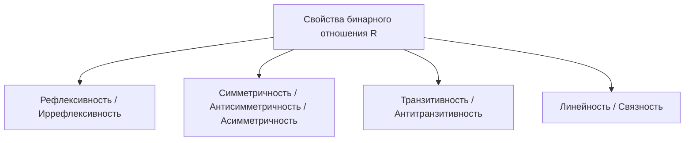

# Свойства бинарных отношений и их замыкания

Конспект составлен на основе объединённых лекционных курсов дискретной математики **Пермякова А.С.** и **Страдиной М.В.**

---

## 1. Фундаментальные свойства отношений на множестве

Пусть $R \subseteq A \times A = A^2$ — однородное бинарное отношение на множестве $A$. В дискретной математике выделяются три ключевых семейства свойств: рефлексивность, симметричность и транзитивность, а также свойства связности (линейности).



---

### 1.1. Рефлексивность и иррефлексивность

> [!NOTE]
> - **Рефлексивность (Reflexivity):** каждый элемент множества находится в отношении с самим собой:
>   $$\forall x \in A \quad (x \, R \, x)$$
>   - *Теоретико-множественный критерий:* $I_A \subseteq R$ (диагональ содержится в отношении).
>   - *В матрице:* на главной диагонали стоят все единицы: $\forall i \; m_{ii} = 1$.
>   - *На графе:* у каждой вершины есть петля.
>
> - **Иррефлексивность / Антирефлексивность (Irreflexivity):** ни один элемент не связан сам с собой:
>   $$\forall x \in A \quad \neg(x \, R \, x)$$
>   - *Теоретико-множественный критерий:* $R \cap I_A = \varnothing$.
>   - *В матрице:* на главной диагонали стоят все нули: $\forall i \; m_{ii} = 0$.
>   - *На графе:* петель нет ни у одной вершины.

> [!WARNING]
> Рефлексивность и антирефлексивность **не являются** логическим отрицанием друг друга!
> Если отношение содержит петли у одних вершин, но не имеет у других, оно является **нерефлексивным и неантирефлексивным**.

*Примеры:*
- Отношение равенства ($=$), $\le$, $\ge$, делимости ($a \mid b$), подобия треугольников — **рефлексивны**.
- Отношения строгого порядка ($<$, $>$), строгого включения ($\subset$), «быть родителем» — **антирефлексивны**.

---

### 1.2. Симметричность, антисимметричность и асимметричность

> [!NOTE]
> - **Симметричность (Symmetry):** если $x$ связан с $y$, то и $y$ связан с $x$:
>   $$\forall x, y \in A \quad (x \, R \, y \implies y \, R \, x)$$
>   - *Критерий:* $R = R^{-1}$.
>   - *В матрице:* симметрична относительно главной диагонали: $M_R = M_R^T$.
>   - *На графе:* между любыми двумя вершинами ребра ненаправленные (или пара встречных дуг).
>
> - **Антисимметричность (Antisymmetry):** встречные связи возможны только при совпадении элементов:
>   $$\forall x, y \in A \quad (x \, R \, y \land y \, R \, x \implies x = y)$$
>   Эквивалентная контрапозиция: $\forall x \ne y \; (x \, R \, y \implies \neg(y \, R \, x))$.
>   - *Критерий:* $R \cap R^{-1} \subseteq I_A$.
>   - *В матрице:* если вне главной диагонали $m_{ij} = 1$ ($i \ne j$), то обязательно $m_{ji} = 0$.
>   - *На графе:* между любыми двумя различными вершинами существует **не более одной** дуги. Петли при этом разрешены!
>
> - **Асимметричность (Asymmetry):** отсутствие встречных связей и отсутствие петель:
>   $$\forall x, y \in A \quad (x \, R \, y \implies \neg(y \, R \, x))$$
>   - *Критерий:* $R \cap R^{-1} = \varnothing$.
>   - *Связь свойств:* **Асимметричность $\iff$ Антисимметричность $+$ Антирефлексивность**.

> [!TIP]
> **Примеры на антисимметричность:**
> - Отношение нестрогого неравенства ($\le$): если $a \le b$ и $b \le a$, то $a = b$ (антисимметрично и рефлексивно).
> - Отношение деления ($a \mid b$) на $\mathbb{N}$: если $a \mid b$ и $b \mid a$, то $a = b$ (антисимметрично).
> - Отношение строгого неравенства ($<$): антисимметрично и асимметрично (петель нет).

---

### 1.3. Транзитивность и антитранзитивность

> [!NOTE]
> - **Транзитивность (Transitivity):** цепочка связей через промежуточный элемент влечёт прямую связь:
>   $$\forall x, y, z \in A \quad (x \, R \, y \land y \, R \, z \implies x \, R \, z)$$
>   - *Теоретико-множественный критерий:* $R \circ R \subseteq R$ ($R^2 \subseteq R$).
>   - *На графе:* для любого пути длины 2 существует «стягивающая» прямая дуга.
>
> - **Антитранзитивность (Antitransitivity):** если есть цепочка через промежуточный элемент, то прямой связи быть не может:
>   $$\forall x, y, z \in A \quad (x \, R \, y \land y \, R \, z \implies \neg(x \, R \, z))$$
>   - *Теоретико-множественный критерий:* $(R \circ R) \cap R = \varnothing$.
>   *Пример:* отношение «быть родителем» (родитель моего родителя — мой дедушка, а не мой родитель).

---

### 1.4. Связность и линейность

> [!NOTE]
> Отношение $R$ называется **связным (линейным / полным)**, если любые два различных элемента сравнимы:
> $$\forall x, y \in A \quad (x \ne y \implies x \, R \, y \lor y \, R \, x)$$
> Если условие выполняется и при $x = y$ ($x \, R \, x$), отношение называют **строго связным**.
>
> **Свойство трихотомии (Trichotomy):** для любых двух элементов $x, y \in A$ выполняется **ровно одно** из трёх соотношений:
> $$x \, R \, y, \quad y \, R \, x, \quad x = y$$
> (характерно для строгого линейного порядка $<$ на $\mathbb{R}$).

---

## 2. Комбинаторный подсчёт отношений на конечном множестве

Пусть $|A| = n$. Матрица отношения $M_R$ размера $n \times n$ имеет:
- $n$ элементов на главной диагонали $(i, i)$.
- $n^2 - n = n(n - 1)$ внедиагональных элементов, разбивающихся на $\frac{n(n - 1)}{2}$ пар симметричных позиций $\{(i, j), (j, i)\}$.

В лекциях Пермякова А.С. и Страдиной М.В. детально выводятся формулы для каждого класса:

| Свойство отношения | Ограничения на диагональ | Ограничения на пару вне диагонали $\{(i,j), (j,i)\}$ | Количество отношений |
| :--- | :--- | :--- | :--- |
| **Всего отношений** | 2 варианта ($0$ или $1$) для каждого из $n$ мест | 4 варианта: $(0,0), (0,1), (1,0), (1,1)$ | $2^{n^2}$ |
| **Рефлексивные** | Все 1 (ровно 1 вариант) | Любые 4 варианта | $1^n \cdot 4^{n(n-1)/2} = \mathbf{2^{n(n-1)}}$ |
| **Антирефлексивные** | Все 0 (ровно 1 вариант) | Любые 4 варианта | $1^n \cdot 4^{n(n-1)/2} = \mathbf{2^{n(n-1)}}$ |
| **Симметричные** | Любые (2 варианта: $0$ или $1$) | 2 варианта: $(0,0)$ или $(1,1)$ | $2^n \cdot 2^{n(n-1)/2} = \mathbf{2^{\frac{n(n+1)}{2}}}$ |
| **Антисимметричные** | Любые ($2^n$) | 3 варианта: $(0,0), (1,0), (0,1)$ | $\mathbf{2^n \cdot 3^{\frac{n(n-1)}{2}}}$ |
| **Асимметричные** | Все 0 ($1^n$) | 3 варианта: $(0,0), (1,0), (0,1)$ | $\mathbf{3^{\frac{n(n-1)}{2}}}$ |
| **Рефлексивные и симметричные** | Все 1 ($1$) | 2 варианта: $(0,0)$ или $(1,1)$ | $\mathbf{2^{\frac{n(n-1)}{2}}}$ |
| **Рефлексивные и антисимметричные**| Все 1 ($1$) | 3 варианта | $\mathbf{3^{\frac{n(n-1)}{2}}}$ |

> [!TIP]
> **Пример:** Для $n = 3$:
> - Всего отношений: $2^9 = 512$.
> - Рефлексивных: $2^{3 \cdot 2} = 2^6 = 64$.
> - Симметричных: $2^{3 \cdot 4 / 2} = 2^6 = 64$.
> - Антисимметричных: $2^3 \cdot 3^{3 \cdot 2 / 2} = 8 \cdot 27 = 216$.

---

## 3. Замыкания бинарных отношений

Часто заданное отношение не обладает нужным свойством (например, транзитивностью), но требуется найти наименьшее расширение отношения, этим свойством обладающее.

> [!NOTE]
> **Замыканием (Closure)** отношения $R \subseteq A \times A$ относительно свойства $P$ называется минимальное по включению надмножество $\mathrm{Cl}_P(R) \supseteq R$, обладающее свойством $P$:
> 1. $R \subseteq \mathrm{Cl}_P(R)$.
> 2. $\mathrm{Cl}_P(R)$ удовлетворяет свойству $P$.
> 3. Если $S$ удовлетворяет свойству $P$ и $R \subseteq S$, то $\mathrm{Cl}_P(R) \subseteq S$.

### 3.1. Рефлексивное замыкание $r(R)$

Чтобы сделать отношение рефлексивным, необходимо добавить все пары вида $(a, a)$, которых в нём не хватает.

$$r(R) = R \cup I_A = R \cup \{ (a, a) \mid a \in A \}$$
В матричном представлении:
$$M_{r(R)} = M_R \lor I$$
(на главную диагональ матрицы просто записываются единицы).

---

### 3.2. Симметричное замыкание $s(R)$

Чтобы сделать отношение симметричным, необходимо добавить все обратные пары:

$$s(R) = R \cup R^{-1}$$
В матричном представлении:
$$M_{s(R)} = M_R \lor M_R^T$$
На графе: для каждой ориентированной дуги добавляется встречная дуга (орграф превращается в неориентированный граф).

---

### 3.3. Транзитивное замыкание $t(R)$ (или $R^+$)

Транзитивное замыкание связывает пары $(a, b)$, между которыми в графе отношения существует ориентированный путь любой положительной длины:

$$t(R) = \bigcup_{k=1}^\infty R^k = R^1 \cup R^2 \cup R^3 \cup \dots$$

> [!IMPORTANT]
> **Теорема о конечности пути (Пермяков А.С., Страдина М.В.):**
> Если множество $A$ конечно и $|A| = n$, то любой простой путь (без самопересечений) имеет длину не более $n - 1$, а путь с возможным замыканием цикла — не более $n$. Следовательно, объединение можно ограничить первыми $n$ степенями:
> $$t(R) = \bigcup_{k=1}^n R^k = R^1 \cup R^2 \cup \dots \cup R^n$$
> В матричном виде:
> $$M_{t(R)} = M_R \lor M_R^2 \lor M_R^3 \lor \dots \lor M_R^n$$

- **Рефлексивно-транзитивное замыкание** $R^*$ (замыкание Клини):
  $$R^* = r(t(R)) = I_A \cup t(R) = \bigcup_{k=0}^n R^k$$

---

## 4. Алгоритм Уоршелла (Warshall's Algorithm)

Прямое возведение булевой матрицы в степени до $n$ требует $O(n \cdot n^3) = O(n^4)$ операций. **Алгоритм Стивена Уоршелла (1962)** находит транзитивное замыкание за время **$O(n^3)$** методом динамического программирования «на месте».

### Идея алгоритма

Пусть вершины занумерованы от $1$ до $n$. Обозначим $W^{(k)}[i, j] = 1$ тогда и только тогда, когда существует ориентированный путь из вершины $i$ в вершину $j$, промежуточные вершины которого принадлежат исключительно множеству $\{1, 2, \dots, k\}$.

- **Базовый шаг ($k = 0$):** Промежуточных вершин нет. $W^{(0)} = M_R$ (исходная матрица).
- **Шаг индукции ($k \to k + 1$):** Путь из $i$ в $j$, использующий промежуточные вершины из $\{1, \dots, k\}$, существует тогда и только тогда, когда:
  1. Либо путь существовал уже без вершины $k$ ($W^{(k-1)}[i, j] = 1$).
  2. Либо существует путь из $i$ в $k$ и путь из $k$ в $j$ через вершины $\{1, \dots, k-1\}$:
     $$W^{(k)}[i, j] = W^{(k-1)}[i, j] \lor \left( W^{(k-1)}[i, k] \land W^{(k-1)}[k, j] \right)$$

```mermaid
flowchart LR
    i((i)) -->|W[i,k]| k((k))
    k((k)) -->|W[k,j]| j((j))
    i -.->|Новая связь W[i,j]| j
```

### Псевдокод алгоритма Уоршелла

```pascal
// W — булева матрица смежности размера n x n
Algorithm Warshall(W, n):
    for k := 1 to n do
        for i := 1 to n do
            if W[i, k] = 1 then
                for j := 1 to n do
                    W[i, j] := W[i, j] or W[k, j]
    return W
```

> [!TIP]
> **Оптимизация проверки:** если $W[i, k] = 0$, то конъюнкция $W[i, k] \land W[k, j]$ тождественно равна нулю, поэтому внутренний цикл по $j$ можно вообще пропустить!

### Пошаговый пример работы алгоритма

Пусть задано отношение на множестве $\{1, 2, 3, 4\}$ с матрицей:
$$W^{(0)} = \begin{pmatrix} 0 & 1 & 0 & 0 \\ 0 & 0 & 0 & 1 \\ 0 & 0 & 0 & 0 \\ 1 & 0 & 1 & 0 \end{pmatrix}$$
*(Граф: $1 \to 2 \to 4 \to 1$, а также $4 \to 3$)*.

1. **Шаг $k = 1$:** Проверяем столбец 1. $W[4, 1] = 1$. К строке 4 прибавляем по $\lor$ строку 1.
   Строка 1: $(0, 1, 0, 0)$. Строка 4 становится: $(1, 0, 1, 0) \lor (0, 1, 0, 0) = (1, 1, 1, 0)$.
2. **Шаг $k = 2$:** Проверяем столбец 2. $W[1, 2] = 1$ и $W[4, 2] = 1$. К строкам 1 и 4 прибавляем строку 2: $(0, 0, 0, 1)$.
   - Строка 1: $(0, 1, 0, 1)$.
   - Строка 4: $(1, 1, 1, 1)$.
3. **Шаг $k = 3$:** Столбец 3 содержит 1 только в позиции $W[4, 3] = 1$. Строка 3 состоит из нулей, изменений нет.
4. **Шаг $k = 4$:** Столбец 4 содержит единицы в строках 1, 2, 4. Прибавляем строку 4: $(1, 1, 1, 1)$ ко всем этим строкам!
   - Строка 1 становится $(1, 1, 1, 1)$.
   - Строка 2 становится $(1, 1, 1, 1)$.
   - Строка 4 остаётся $(1, 1, 1, 1)$.

Итоговая матрица транзитивного замыкания $W^{(4)}$:
$$M_{t(R)} = \begin{pmatrix} 1 & 1 & 1 & 1 \\ 1 & 1 & 1 & 1 \\ 0 & 0 & 0 & 0 \\ 1 & 1 & 1 & 1 \end{pmatrix}$$

Из вершин 1, 2, 4 достижимы все вершины 1, 2, 3, 4; из вершины 3 недостижима ни одна вершина. Алгоритм отработал абсолютно точно!
