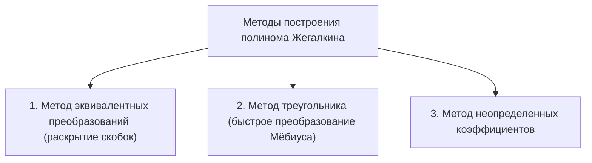
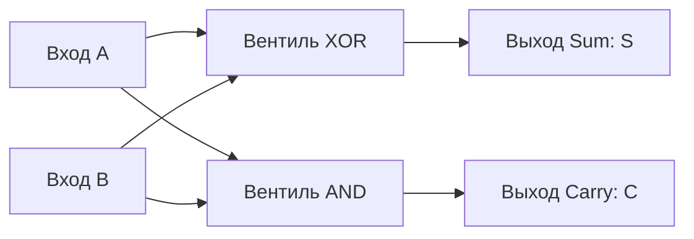

# Полиномы Жегалкина и комбинационные логические схемы

Конспект составлен на основе объединённых лекционных курсов дискретной математики **Пермякова А.С.** и **Страдиной М.В.**

---

## 1. Алгебра Жегалкина и поле $\mathbb{F}_2$

В 1927 году советский математик Иван Иванович Жегалкин предложил арифметизацию математической логики, представив булеву логику как алгебру многочленов над конечным полем из двух элементов $\mathbb{F}_2 = \mathrm{GF}(2) = (\{0, 1\}, \oplus, \cdot)$.

> [!NOTE]
> **Базис Жегалкина** состоит из двух операций:
> 1. Сложение по модулю 2 (XOR / симметрическая разность): $\oplus$.
> 2. Конъюнкция (умножение): $\land$ (или $\cdot$).
> А также логической константы $\mathbf{1}$.

### Фундаментальные алгебраические законы поля $\mathbb{F}_2$

1. **Коммутативность:**
   $$x \oplus y = y \oplus x, \quad x \cdot y = y \cdot x$$
2. **Ассоциативность:**
   $$(x \oplus y) \oplus z = x \oplus (y \oplus z), \quad (x \cdot y) \cdot z = x \cdot (y \cdot z)$$
3. **Дистрибутивность умножения относительно сложения:**
   $$x \cdot (y \oplus z) = (x \cdot y) \oplus (x \cdot z)$$
4. **Свойства нуля и единицы:**
   $$x \oplus 0 = x, \quad x \cdot 1 = x, \quad x \cdot 0 = 0$$
5. **Нилпотентность сложения (самоаннулирование):**
   $$x \oplus x = 0$$
   *(Каждый элемент является своим собственным противоположным: $-x = x$ в $\mathbb{F}_2$).*
6. **Идемпотентность умножения:**
   $$x \cdot x = x \quad (x^k = x \text{ для любого целого } k \ge 1)$$

---

### Выражение классических булевых операций в базисе Жегалкина

> [!IMPORTANT]
> - **Отрицание:**
>   $$\overline{x} = x \oplus 1$$
> - **Дизъюнкция:**
>   $$x \lor y = x \oplus y \oplus (x \cdot y)$$
> - **Импликация:**
>   $$x \implies y = \overline{x} \lor y = (x \oplus 1) \lor y = x \cdot y \oplus x \oplus 1$$
> - **Эквивалентность:**
>   $$x \sim y = x \oplus y \oplus 1$$
> - **Штрих Шеффера:**
>   $$x \mid y = x \cdot y \oplus 1$$

---

## 2. Полином Жегалкина

> [!NOTE]
> **Полиномом (многочленом) Жегалкина** называется сумма по модулю 2 элементарных произведений (конъюнкций) неповторяющихся переменных:
> $$P(x_1, \dots, x_n) = \bigoplus_{(\alpha_1, \dots, \alpha_n) \in \{0, 1\}^n} c_{\alpha_1 \alpha_2 \dots \alpha_n} \cdot x_1^{\alpha_1} x_2^{\alpha_2} \dots x_n^{\alpha_n}$$
> где коэффициенты $c_{\alpha_1 \dots \alpha_n} \in \{0, 1\}$, а $x_i^1 = x_i, \; x_i^0 = 1$.
>
> Слагаемое с нулевым набором степеней $c_{00\dots0}$ представляет собой **свободный член** полинома.

### Теорема существования и единственности

> [!IMPORTANT]
> **Теорема Жегалкина (Пермяков А.С., Страдина М.В.):**
> Всякая булева функция от $n$ переменных может быть представлена в виде полинома Жегалкина, притом **единственным образом** (с точностью до перестановки слагаемых и сомножителей).
>
> *Доказательство:*
> 1. Число различных конъюнкций из $n$ переменных равно числу подмножеств $n$-элементного множества, то есть $2^n$.
> 2. Каждая конъюнкция может либо входить в полином (коэффициент 1), либо не входить (коэффициент 0). Следовательно, число различных полиномов Жегалкина от $n$ переменных равно:
>    $$2^{2^n}$$
> 3. Общее число всевозможных булевых функций от $n$ переменных также равно $2^{2^n}$.
> 4. Поскольку отображение множества полиномов в множество булевых функций инъективно (разные полиномы задают разные функции), по принципу Дирихле для конечных множеств одинаковой мощности оно является **биекцией**.

---

## 3. Методы построения полинома Жегалкина

В лекциях обоих преподавателей подробно разбираются три основных практических метода.



---

### Метод 1: Эквивалентные аналитические преобразования

Формула булевой функции преобразуется заменой связок:
1. Заменить все отрицания $\overline{A}$ на $(A \oplus 1)$.
2. Заменить все дизъюнкции $A \lor B$ на $(A \oplus B \oplus A B)$.
3. Раскрыть скобки по закону дистрибутивности.
4. Привести подобные слагаемые по правилам: $x \oplus x = 0$, $x \cdot x = x$, $x \oplus 0 = x$.

*Пример:* Найти полином Жегалкина для $f(x, y) = x \implies y$.
$$f(x, y) = \overline{x} \lor y = (x \oplus 1) \lor y = (x \oplus 1) \oplus y \oplus (x \oplus 1)y = x \oplus 1 \oplus y \oplus xy \oplus y = xy \oplus x \oplus 1$$

---

### Метод 2: Метод треугольника Паскаля (Быстрое преобразование Мёбиуса)

Этот алгоритм работает за время $O(n \cdot 2^n)$ и является самым быстрым при известном векторе значений функции.

**Алгоритм:**
1. В первый столбец таблицы выписывается вектор значений функции длины $2^n$ (в порядке возрастания двоичных кодов наборов).
2. Каждый элемент следующего столбца вычисляется как сумма по модулю 2 двух соседних элементов предыдущего столбца:
   $$T[i, j] = T[i, j - 1] \oplus T[i + 1, j - 1]$$
3. Первая строка получившегося треугольника задает коэффициенты полинома Жегалкина $c_{\tilde{\alpha}}$!

#### Пример для функции трех переменных $f(x, y, z)$ с вектором $(1, 0, 1, 1, 0, 1, 1, 1)$:

```
Вектор f    Столбец 1   Ст. 2   Ст. 3   Ст. 4   Ст. 5   Ст. 6   Ст. 7   Коэффициенты
  1 --------- 1 --------- 0 ----- 1 ----- 0 ----- 0 ----- 0 ----- 0  -> c_000 = 1 (1)
  0           1           1       1       0       0       0           -> c_001 = 1 (z)
  1           0           0       1       0       0                   -> c_010 = 0
  1           1           1       1       0                           -> c_011 = 1 (yz)
  0           1           0       1                                   -> c_100 = 0
  1           0           1                                           -> c_101 = 0
  1           0                                                       -> c_110 = 0
  1                                                                   -> c_111 = 0
```
Коэффициенты первой строки: $c_0 = 1, c_z = 1, c_y = 0, c_{yz} = 1, c_x = 0, c_{xz} = 0, c_{xy} = 0, c_{xyz} = 0$.
**Полином Жегалкина:**
$$P(x, y, z) = 1 \oplus z \oplus yz$$

---

### Метод 3: Метод неопределённых коэффициентов

Полином записывается в общем виде с неизвестными коэффициентами:
$$P(x, y, z) = c_0 \oplus c_1 x \oplus c_2 y \oplus c_3 z \oplus c_{12} xy \oplus c_{13} xz \oplus c_{23} yz \oplus c_{123} xyz$$
Подставляя последовательно наборы $(0,0,0), (0,0,1), (0,1,0), \dots$ в порядке возрастания числа единиц, получаем треугольную систему линейных уравнений над $\mathbb{F}_2$:
- При $(0, 0, 0)$: $P(0, 0, 0) = c_0 = f(0, 0, 0)$.
- При $(0, 0, 1)$: $P(0, 0, 1) = c_0 \oplus c_3 = f(0, 0, 1) \implies c_3 = c_0 \oplus f(0, 0, 1)$.
- И так далее.

---

## 4. Функциональные комбинационные схемы

> [!NOTE]
> **Комбинационной логической схемой (Functional Logic Circuit)** называется ориентированный ациклический граф (DAG), вершины которого представляют собой логические вентили (логические элементы), а дуги — линии передачи двоичных сигналов.

### Метрики качества логических схем:
1. **Сложность (размер) схемы $L(S)$:** общее количество логических вентилей в схеме.
2. **Глубина (задержка) схемы $D(S)$:** максимальная длина пути от любого входа до любого выхода схемы. Глубина определяет максимальную тактовую частоту процессора ($f_{\max} \propto 1 / D(S)$).

---

## 5. Синтез арифметических сумматоров

Основой арифметико-логического устройства (АЛУ) компьютера является сумматор двоичных чисел.

### Полусумматор (Half-Adder, HA)
Складывает два однобитных числа $A$ и $B$, вырабатывая бит суммы $S$ и бит переноса $C$:

| $A$ | $B$ | Сумма $S$ ($A + B \bmod 2$) | Перенос $C$ ($A + B \ge 2$) |
| :---: | :---: | :---: | :---: |
| 0 | 0 | 0 | 0 |
| 0 | 1 | 1 | 0 |
| 1 | 0 | 1 | 0 |
| 1 | 1 | 0 | 1 |

> [!IMPORTANT]
> **Формулы полусумматора:**
> $$S = A \oplus B$$
> $$C = A \land B$$



---

### Полный сумматор (Full Adder, FA)
Учитывает перенос $C_{\text{in}}$ из младшего разряда:

> [!IMPORTANT]
> **Формулы полного сумматора:**
> $$S = A \oplus B \oplus C_{\text{in}}$$
> $$C_{\text{out}} = (A \land B) \lor (C_{\text{in}} \land (A \oplus B)) = (A \land B) \lor (B \land C_{\text{in}}) \lor (A \land C_{\text{in}})$$

Полный сумматор строится из двух полусумматоров и одного элемента OR:
1. Первый полусумматор: $S_1 = A \oplus B$, $C_1 = A \land B$.
2. Второй полусумматор: $S = S_1 \oplus C_{\text{in}}$, $C_2 = S_1 \land C_{\text{in}}$.
3. Итоговый перенос: $C_{\text{out}} = C_1 \lor C_2$.
